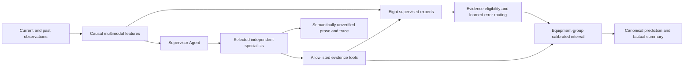

# MERA-PHM

[](https://github.com/13536309143/mera-phm/actions/workflows/ci.yml) · [MIT](LICENSE) · Python ≥ 3.12
### Maintenance-aware Evidence Routing for Agentic Prognostics

[English](README.md) · [简体中文](README.zh-CN.md) · [Validation results](results/validation/README.md) · [Research protocol](docs/research-design.md)


**A CPU-first research system for predicting the degradation level at the next scheduled inspection from numerical records, transient-curve images, and inspection text.** MERA-PHM combines maintenance-aware evidence memory, availability-constrained model routing, equipment-group prediction intervals, and optional auditable LLM tool orchestration.

The numerical forecaster and the language agents have separate responsibilities. **Agents inspect and explain evidence; they do not generate or overwrite the canonical regression value.** This is feature-based multimodal learning with ExtraTrees and TF-IDF, not a reproduction of the source paper's neural network or direct image input to a vision-language model.

## What the project provides

- Causal observation prefixes and an offline-only target loader.
- Eight modality/fusion experts, learned error routing, and explicit fallbacks for missing evidence.
- Historical-image invalidation after maintenance, with image-age and text-change-age features.
- Split-conformal intervals based on maximum residuals per calibration equipment trajectory.
- Nine available Agent responsibilities with independent specialist contexts and restricted tools.
- Deterministic control, a one-context single Agent, and dynamic multi-Agent orchestration.
- Five equipment folds, matched-label baselines, full component ablations and seven causal stress conditions.
- A local dashboard, reproducible CLI, original toy generator, credential checks and offline tests.

## Quick start — no API or external dataset

```bash
python3 -m venv .venv
source .venv/bin/activate                 # Windows: .venv\Scripts\activate
python -m pip install -e .
mera-phm demo
mera-phm predict --data data/demo --model artifacts/demo-model/model-bank.joblib --equipment 2 --row 8 --mode local
mera-phm serve --data data/demo --model artifacts/demo-model/model-bank.joblib --open
```

Open **http://127.0.0.1:8765**. The dashboard currently uses Chinese labels. `python main.py` accepts the same commands as `mera-phm`. The original toy generator verifies installation and software behavior; it is **not** the paper's simulator or evidence of industrial accuracy. Output directories must not already exist.

The predictive models run on CPU; CUDA and local LLM deployment are not required. Local prediction, training and software tests make no API requests.

## Architecture



A pre-maintenance image can describe a state that repair changed. MERA-PHM removes it from event-aware memory rather than treating it as current post-maintenance evidence. The gate first restricts experts by available evidence, then chooses the candidate with the lowest learned expected error. Missing text triggers numerical/image fallbacks. Model experts are evaluated independently of which language specialists are delegated.

Agent responsibilities: supervisor, quality, numerical, visual, text, maintenance, retrieval, uncertainty, and audit. The supervisor checks quality, delegates at least two predictive specialists, calls fusion, and then audits provenance. The single-Agent control retrieves equivalent evidence in one context. Retrieval uses training equipment archives and excludes the current equipment. No arbitrary file, shell, credential, future-query-label, or physical-device tools are exposed.

## Research results

The release evaluation uses **50 equipment trajectories and 7,626 observations**, with each equipment tested exactly once across five folds. Each fold contains **25 expert-training / 5 routing / 10 calibration / 10 test devices**. Vocabulary is fitted on the 25 training devices. Thirty-device static baselines control for the router's additional five-device label budget. Units are `adu` for degradation and `atu` for time; the target is not RUL or current fault classification.

| Method | OOF MAE ↓ | Device macro MAE ↓ | RMSE ↓ |
|---|---:|---:|---:|
| Numeric expert | 6.4884 | 6.4900 | 9.0375 |
| Static fusion (25 devices) | 2.9759 | 2.9758 | 4.9346 |
| Ordinary history fusion | 2.7834 | 2.7860 | 4.6642 |
| Random forest fusion (30 devices) | 3.3124 | 3.3116 | 5.3514 |
| Static ExtraTrees (30 devices) | 2.7590 | 2.7584 | 4.6994 |
| Router without freshness | 2.7406 | 2.7427 | 4.8286 |
| Router without maintenance reset | 2.7384 | 2.7410 | 4.7030 |
| MERA constrained router | 2.6919 | 2.6958 | 4.7726 |


The constrained router improves OOF MAE by about **9.5%** over 25-device static fusion, but only about **2.4%** over the 30-device ExtraTrees control. The descriptive paired-device interval for improvement over that stronger control includes zero. Removing freshness or maintenance reset changes MAE modestly; the reset-effect interval also includes zero. These results support investigation, not a claim that every component is independently established.


Under complete image outage, static fusion MAE is **17.155**, versus **3.998** for constrained routing; under combined image/text outage, the corresponding values are **22.795** and **6.488**. Random additional image masking and contiguous outages rebuild memory from surviving past observations, so a dropped current image cannot remain hidden in history. Curve-feature perturbation is a descriptor-level stress test, not raw sensor corruption. Complete conditions and stronger-baseline results are published, including cases where the router does not win.

A negative result matters: under additional random image masking, the router MAE is **6.257**, compared with **3.998** for the numerical/text expert. Under descriptor perturbation, the 30-device static control also slightly outperforms the router. Eligibility and historical memory do not make the system robust to every missingness pattern.

The router's mean interval width is **64.15 adu**, with observed whole-equipment coverage of **94%**. Intervals are conservative and depend on exchangeable equipment groups. High coverage with wide intervals is not evidence of precise maintenance decisions; distribution-shift tests do not inherit nominal coverage guarantees.

**Evidence status:** the same synthetic dataset had already been explored, and eligibility rules were improved after early stress testing. The five-fold evaluation remains exploratory internal validation. It is not external industrial confirmation, a world-first claim, or a direct comparison with the original paper's differently evaluated CNN. Historical pilot results are kept separately and not pooled with this benchmark.

## Agent validation and cost

The expanded opt-in study uses **24 paired cases in six causal quality strata**, four distinct held-out equipment per stratum. It measured **822,665 tokens over 658 requests**, including independent language screening, separate rescue runs and eight specialist smoke tests. No runs were truncated by the shared experiment allocation; individual session and tool-loop limits still apply.

| Mode | Completed / attempted | Requests | Measured tokens |
|---|---:|---:|---:|
| Deterministic local control | 24 / 24 | 0 | 0 |
| Single Agent, default budget | 22 / 24 | 117 | 208,038 |
| Multi-Agent, default budget | 11 / 24 | 272 | 307,492 |
| Multi-Agent rescue on failed cases | 9 / 13 | 191 | 221,522 |

The rescue column is a **fresh, separate run with up to 20 requests**, not a replacement for the default-budget failure. Default sessions permit 12 requests; both settings retain the same 24,000 completion-token ceiling and bounded tool loops. All eight specialist roles completed independent evidence-tool smoke tests. All 85 structured case outputs, including failed sessions and rescues, preserved the fixed model's point and interval outputs.

Multi-Agent orchestration completed less reliably and consumed more tokens than the single-Agent control in this sample. Independent model-assisted screening flagged possible evidence contradictions in 14/22 screened single-Agent runs and 20/24 screened default multi-Agent runs. **These are screening flags, not adjudicated error rates or measured semantic accuracy.** Digit rejection prevents invented numeric prose but does not prove qualitative factual correctness. This release is a research prototype; reliable industrial Agent interpretation is not established.


See the [expanded protocol and complete ledger](results/agent-validation-full/README.md). The earlier [48,170-token budget-censored pilot](results/agent-validation/README.md) remains separate and is not pooled with this study.

```bash
cp .env.example .env
# Fill MODEL_API_KEY, MODEL_NAME and MODEL_BASE_URL with your own compatible provider.
mera-phm predict --data data/demo --model artifacts/demo-model/model-bank.joblib --equipment 2 --row 8 --mode api
```

Real keys belong only in ignored local configuration or environment variables. Chat Completions tool support is required; the real integration study used MiniMax, whose model is recorded in the protocol. Optional reasoning settings can be omitted for other compatible providers.

Each prediction permits at most 12 requests, 4,096 completion tokens/request and 24,000 total completion tokens. Prompt tokens are additional; these limits are not monetary caps. Successful multi-Agent outputs are cached by observation, model, policy, protocol and provider identity. Cache replay makes no new request and retains the original usage record. Original LLM prose is marked as semantically unverified; canonical values and a code-generated factual summary take precedence.

## Reproduce the paper-dataset experiments

Obtain the original dataset separately; see [data attribution and layout](docs/dataset.md). Raw data, original record text, per-row labels/predictions and model binaries are not redistributed.

```bash
mera-phm audit --data "data/raw/Multimodal data for prognostics"
mera-phm train --data "data/raw/Multimodal data for prognostics" --output artifacts/my-model
mera-phm benchmark --data "data/raw/Multimodal data for prognostics" --output results/my-validation
python scripts/render_research_figures.py

# Opt-in: this command makes real API requests and logs measured usage.
python -m prognostics.full_agent_benchmark --data "data/raw/Multimodal data for prognostics" --model artifacts/my-model/model-bank.joblib --output results/my-agent-validation --workers 3
```

Published [protocols and fold assignments](results/validation/protocol.json) include fixed parameters, dataset fingerprint and execution-source hashes. The numerical source snapshot preserves the code used for the reported run before later formatting. All device targets stay in ignored local artifacts. A new run can generate its own source snapshot and results.

## Repository map

```text
prognostics/       Causal loader, experts, routing, agents, benchmarks and packaged dashboard
scripts/           Figures and public-release checks
tests/             Temporary-data invariants and scripted-provider fault tests
results/           Aggregate metrics, fold protocols and bounded API ledger
docs/              Research design, dataset notes and figures
.github/workflows/ Offline test and clean-demo CI
.env.example       Credential placeholders
```

## Verification and contributing

```bash
python -m pip install -r requirements-dev.txt
python -m unittest discover -s tests -v
ruff check prognostics tests scripts main.py
ruff format --check prognostics tests scripts main.py
python scripts/check_release.py
```

Tests need neither the original dataset nor API keys. They cover causal prefixes, target isolation, equipment grouping, calibration ranks, fallback behavior, independent Agent contexts, invalid tools, early fusion, invented numerical prose, provider failures, unknown usage, budgets, persistence and cache replay. Scripted-provider fault tests are software checks, not real LLM robustness estimates. CI is configured for Python 3.12–3.14; only report remote CI success after GitHub actually runs it.

See [contributing](CONTRIBUTING.md) and [credential handling](SECURITY.md). Please report negative outcomes and preserve the distinction between numerical accuracy and orchestration quality.

## Attribution and license

The source and original toy generator are MIT-licensed; this does not license the original dataset or external models. Cite the software using [CITATION.cff](CITATION.cff), and cite Yang, Baraldi and Zio's [original dataset paper](https://doi.org/10.1016/j.jmsy.2021.01.007) when using their data. Related-work distinctions and calibration assumptions are documented in [research design](docs/research-design.md).
