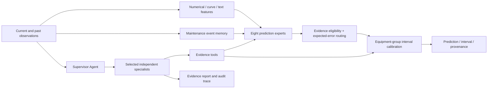

# MERA-PHM

### Maintenance-aware multimodal prognostics and auditable Agent collaboration

[English](README.md) · [简体中文](README.zh-CN.md) · [Technical manual](docs/technical-manual.md) · [中文技术手册](docs/technical-manual.zh-CN.md) · [Experiment index](experiments/README.md) · [Research design](docs/research-design.md)

[](https://github.com/13536309143/mera-phm/actions/workflows/ci.yml) · MIT · Python 3.12+

**Predict degradation at the next scheduled inspection from numerical records, transient-curve images, inspection text and maintenance history, with calibrated intervals, evidence provenance and Agent traces.**

MERA-PHM treats maintenance as a change in evidence validity. It connects trained modality experts, event-aware historical memory, error routing and LLM tool collaboration in one workflow. CPU tree models are the default; an optional PyTorch backend supports CPU, CUDA and MPS.

## 1. Problem and outputs

Industrial observations are intermittent. An image may be missing, text may repeat an earlier inspection, and a pre-repair image may describe an equipment state that no longer exists. The most useful modality can also depend on the forecast horizon.

| Input | Processing | Result |
|---|---|---|
| Inspection horizon, repair time, cleaning counts | Numerical expert | Numerical prediction |
| Transient-curve image | Geometric and statistical descriptors | Current image evidence |
| Inspection record | TF-IDF and source-text tools | Text prediction and supporting evidence |
| Past images, maintenance events, evidence ages | Event-aware memory | Historical evidence eligibility |
| Expert predictions and quality state | Learned error routing and group calibration | Degradation value and interval |
| Model/tool outputs | Single- or multi-Agent orchestration | Report, audit trace and API usage |

Each prediction saves `result.json` and `report.md`. Degradation uses arbitrary degradation units (`adu`), and time uses arbitrary time units (`atu`). The target is the next scheduled inspection level.

## 2. How it works



**Maintenance-aware memory.** Repair timing determines whether the most recent image predates maintenance. Invalid historical images are removed from post-maintenance memory. Image age and text-change age inform the gate about freshness.

**Evidence-constrained expert selection.** Eight experts cover numerical, text, image, numerical/text, numerical/image, static fusion, ordinary history and event-aware history. A gate learns candidate experts' expected errors on separate devices, then selects an eligible expert. Missing modalities have explicit fallbacks.

**Intervals and tool-grounded Agents.** Split-conformal intervals use maximum residuals per calibration equipment trajectory. Agents retrieve model predictions, quality information and completed training-archive examples through restricted tools, then perform fusion and provenance auditing. The numerical tool supplies the structured prediction.

**Two training backends.** `trees` uses ExtraTrees; `neural` uses feature MLPs. Both share features, equipment partitions, routing and calibration. Neural experts support CPU/CUDA/MPS training and inference; preprocessing, error routing and calibration use CPU.

## 3. Environment

| Platform | Tree backend | Neural backend |
|---|---|---|
| macOS, Apple Silicon | CPU | CPU / MPS |
| macOS, Intel | CPU | Subject to available PyTorch builds |
| Windows | CPU | CPU / NVIDIA CUDA |
| Linux | CPU | CPU / NVIDIA CUDA |

Use **Python 3.12+, preferably 3.13**. The base installation runs the local workflow. API mode requires a Chat Completions provider with tool calling. LLMs run through the provider API; prediction models train locally.

CUDA requires an NVIDIA GPU, driver and matching PyTorch build. Choose the installation command with the [official PyTorch selector](https://pytorch.org/get-started/locally/). Apple Silicon uses [MPS](https://docs.pytorch.org/docs/stable/notes/mps.html).

## 4. Install and launch

```bash
git clone https://github.com/13536309143/mera-phm.git
cd mera-phm
```

### macOS / Linux

```bash
python3 -m venv .venv
source .venv/bin/activate
python -m pip install -e .
python main.py doctor
python main.py demo
python main.py serve --data data/demo --model artifacts/demo-model/model-bank.joblib --open
```

### Windows Command Prompt / CMD

```bat
py -3 -m venv .venv
.venv\Scripts\activate.bat
python -m pip install -e .
python main.py doctor
python main.py demo
python main.py serve --data data/demo --model artifacts/demo-model/model-bank.joblib --open
```

In PowerShell, the environment's interpreter can be used directly: `& .\.venv\Scripts\python.exe main.py doctor`.

Open **http://127.0.0.1:8765** and select equipment, observation, prediction policy and Agent mode. `demo` creates sample data and trains a model for a quick end-to-end experience.

Alternatively, double-click `start-lab.command` on macOS or `start-lab.cmd` on Windows. The shared launcher prepares the environment and demo model. `start-demo` runs a local prediction; `start-api` runs a multi-Agent API prediction. `mera-phm` can replace `python main.py` in all CLI examples.

## 5. Configure the API

Copy the configuration template:

```bash
# macOS / Linux
cp .env.example .env
```

```bat
rem Windows CMD
copy .env.example .env
```

Fill `.env` with your provider settings:

```dotenv
MODEL_API_KEY=your-api-key
MODEL_NAME=your-tool-calling-model
MODEL_BASE_URL=https://api.minimax.cn/v1
API_STYLE=chat
# Optional; remove if unsupported by your provider
MODEL_REASONING_EFFORT=low
```

For MiniMax, use your subscription key, model and compatible endpoint. The measured provider model is recorded in the Agent protocol. Other compatible providers use the same fields. `doctor` checks configuration without revealing keys or making API requests.

```bash
python main.py doctor
python main.py predict --data data/demo --model artifacts/demo-model/model-bank.joblib --equipment 2 --row 8 --mode api
```

| Mode | Workflow | API requests |
|---|---|---|
| `local` | Local predictor and deterministic evidence flow | None |
| `single` | One Agent context for evidence and auditing | Yes |
| `api` | Supervisor delegates independent specialists | Yes |

The supervisor can select quality, numerical, visual, text, maintenance, retrieval, uncertainty and audit specialists. A prediction permits 12 requests, at most 4,096 completion tokens/request and 24,000 completion tokens/session. Prompt tokens are additional. Successful multi-Agent results can be replayed from local cache.

## 6. Data and training

Place the dataset in `data/raw/Multimodal data for prognostics/`, containing equipment directories `1`–`50`. Existing data can be supplied with `--data` or `DATASET_PATH` in `.env`. Prefer forward slashes in Windows paths, for example `D:/datasets/Multimodal data for prognostics`.

See [dataset layout, fields and attribution](docs/dataset.md).

### Default CPU tree models

```bash
python main.py audit --data "data/raw/Multimodal data for prognostics"
python main.py train --data "data/raw/Multimodal data for prognostics" --backend trees --output artifacts/my-model
python main.py predict --data "data/raw/Multimodal data for prognostics" --model artifacts/my-model/model-bank.joblib --equipment 2 --row 100 --mode local
python main.py serve --data "data/raw/Multimodal data for prognostics" --model artifacts/my-model/model-bank.joblib --open
```

Training saves the model, test metrics, calibration information and report. Omitting `--output` creates a timestamped model directory.

### Neural models and GPUs

Install the optional dependency on Apple Silicon macOS, or Windows/Linux CPU:

```bash
python -m pip install -e ".[neural]"
python main.py doctor
```

On Windows/Linux with CUDA, install the matching CUDA build through the [PyTorch selector](https://pytorch.org/get-started/locally/), then install `.[neural]`.

```bash
python main.py doctor --device cuda
python main.py train --data "data/raw/Multimodal data for prognostics" --backend neural --device cuda --epochs 80 --output artifacts/neural-model
```

Use `--device mps` on Apple Silicon, `--device cpu` for CPU, or `--device auto` for automatic selection. Portable saved weights can be loaded across those environments. Training reports record the actual training device.

## 7. Experimental results

### Prediction quality

The dataset contains **50 equipment trajectories and 7,626 observations**. Five equipment folds test each device once. Each fold uses **25 expert-training / 5 routing / 10 calibration / 10 test devices**. Both backends use identical partitions.

| Method | OOF MAE ↓ | RMSE ↓ |
|---|---:|---:|
| Numerical tree expert | 6.488 | 9.038 |
| Static tree fusion, 25 training devices | 2.976 | 4.935 |
| Strong static tree control, 30 devices | 2.759 | 4.699 |
| **MERA tree routing** | **2.692** | **4.773** |
| Static feature MLP | 7.145 | 11.934 |
| MERA MLP routing | 6.630 | 11.301 |

Tree routing reduces MAE by about **9.5%** relative to the 25-device static fusion baseline and **2.4%** relative to the matched-label strong control. Trees outperform the tested feature MLP on this dataset and remain the default.

With complete image outage, static fusion MAE is **17.155** versus routed **3.998**. Under additional random image masking, routing gives **6.257**, while numerical/text gives **3.998**. Mean interval width is **64.15 adu**, with **94%** observed whole-equipment coverage. All ablations, seven stress conditions and fold results are organized in the [experiment index](experiments/README.md).


### Agent completion and cost

The six-stratum, 24-case paired API study measured **822,665 tokens over 658 requests**, including independent language screening and eight specialist smoke tests.

| Mode | Completed / attempted | Measured tokens |
|---|---:|---:|
| Local control | 24 / 24 | 0 |
| Single Agent | 22 / 24 | 208,038 |
| Default-budget multi-Agent | 11 / 24 | 307,492 |
| Separate higher-budget rescue on failures | 9 / 13 | 221,522 |

All eight specialist smoke tests completed. Single Agent used fewer tokens and completed more often in this sample. Evidence specialization, traceability and orchestration reliability are the focus of the multi-Agent layer. See the [complete Agent study](experiments/agents/paired-api/README.md).

### Run your own experiments

```bash
python main.py experiments
python main.py benchmark --data "data/raw/Multimodal data for prognostics" --backend trees --output artifacts/experiments/tree-run
python main.py benchmark --data "data/raw/Multimodal data for prognostics" --backend neural --device cuda --epochs 80 --output artifacts/experiments/neural-run
python main.py agent-benchmark --data "data/raw/Multimodal data for prognostics" --model artifacts/my-model/model-bank.joblib --output artifacts/experiments/api-run
```

Numerical experiments use no API. `agent-benchmark` uses `.env`. Each study saves its protocol, assignments, aggregates and execution-source snapshot. Published studies live under `experiments/`; local reproductions use `artifacts/`.

## 8. Repository layout

```text
prognostics/
  data.py            Causal loader and modality features
  models.py          Experts, routing, calibration and persistence
  neural.py          CPU / CUDA / MPS neural backend
  agents.py          Single- and multi-Agent tool workflows
  benchmark.py       Grouped prediction and stress experiments
  full_agent_benchmark.py  Paired real API evaluation
  cli.py / runtime.py     Commands and environment checks
  server.py / web/         Local dashboard
experiments/
  numerical/         Tree and neural prediction studies
  agents/            Full Agent comparison
  archive/           Earlier pilot studies
scripts/             Portable launcher, plots and release checks
tests/               Data, model, Agent and portability checks
docs/                Methods and dataset documentation
data/                Local original data and generated sample data
artifacts/           Local models and experiment runs
runs/                Prediction reports and cache
```

## 9. Development and citation

```bash
python -m pip install -r requirements-dev.txt
python -m unittest discover -s tests -v
ruff check prognostics tests scripts main.py
python scripts/check_release.py
```

CI covers macOS, Windows and Linux, with separate base and optional neural workflows. Accelerator execution depends on the hardware available to a runner.

The research focus is maintenance-dependent evidence validity and auditable routing. Current results use the paper's simulated equipment data. Numerical improvement and Agent behavior are evaluated separately; hypotheses, controls, negative results and assumptions are documented in [research design](docs/research-design.md).

Code and the sample generator are MIT-licensed; original data is obtained separately. Cite [Yang, Baraldi and Zio](https://doi.org/10.1016/j.jmsy.2021.01.007) for the data and [CITATION.cff](CITATION.cff) for the software. See [CONTRIBUTING.md](CONTRIBUTING.md) and [SECURITY.md](SECURITY.md).
