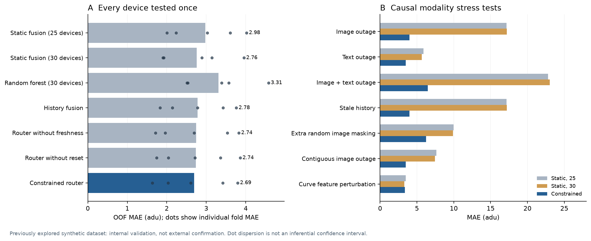
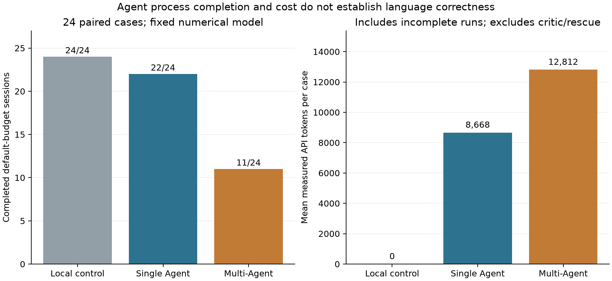

# MERA-PHM

[](https://github.com/13536309143/mera-phm/actions/workflows/ci.yml) · [MIT](LICENSE) · Python ≥ 3.12
### 维护感知证据路由与可审计多智能体退化预测

[English](README.md) · [简体中文](README.zh-CN.md) · [完整实验结果](results/validation/README.md) · [研究设计](docs/research-design.md)

**面向下一次计划巡检退化水平预测的 CPU 多模态研究系统。** MERA-PHM 融合数值记录、瞬态曲线图和巡检文本，包含维护事件历史记忆、证据可用性约束、学习路由、设备组校准区间，以及可选的 LLM 工具协作。

预测模型与语言 Agent 的职责分开：**模型负责最终数值，Agent 负责按需取证、协作和解释，文字意见不改变回归值。** 当前采用 ExtraTrees、曲线特征和 TF-IDF，没有复现原论文的 CNN，也没有把图片直接输入视觉语言模型。

## 项目能力

- 仅使用截至当前的观测前缀；未来标签只供离线训练与评价。
- 八个单模态与融合预测专家，以及受证据有效性约束的学习路由。
- 维修前旧图像失效处理、图像年龄和文本变化年龄代理量。
- 按设备整条轨迹最大残差构造的 split conformal 区间。
- 九类 Agent 职责，独立专家上下文、受限工具、融合后审计和完整用量记录。
- 确定性流程、单 Agent、多 Agent 三种对照。
- 五折整设备验证、训练标签预算对照、全系统特征消融和七种压力条件。
- 本地实验界面、可复现实验命令、原创演示数据、离线测试与发布检查。

## 快速开始：不需要 API 或外部数据

```bash
python3 -m venv .venv
source .venv/bin/activate                 # Windows：.venv\Scripts\activate
python -m pip install -e .
mera-phm demo
mera-phm predict --data data/demo --model artifacts/demo-model/model-bank.joblib --equipment 2 --row 8 --mode local
mera-phm serve --data data/demo --model artifacts/demo-model/model-bank.joblib --open
```

打开 **http://127.0.0.1:8765**。也可以使用 `python main.py` 执行同名子命令。演示数据是本项目原创的软件检查夹具，**不是原论文的模拟器，也不能作为工业预测精度的证据**。输出目录必须尚不存在。

模型训练和预测使用 CPU，不需要 CUDA 或本地部署大语言模型。本地预测、训练与软件测试不调用 API。

## 核心原理

假设设备已经维修，而最近图像来自维修之前。这张图像不能代表当前维修后状态。系统先判断证据是否仍然有效，再从有资格的候选预测模型中选择预计误差最小者。缺少文本时，回退到数值＋图像或纯数值模型。全部预测模型的计算独立于语言 Agent 选择了哪些专家。

数值、图像、文本、数值＋文本、数值＋图像、静态三模态、普通历史和维护事件历史构成八个模型专家。另一层支持监督、质量、数值、视觉、文本、维护、检索、不确定性与审计九类 Agent 职责；它们是工具协作角色，与模型专家不是同一概念。

API 模式要求监督 Agent 检查质量、完成至少两位预测专家、调用融合后再审计。单 Agent 对照在一个上下文内完成对应的取证步骤。检索只读取训练设备的已完成历史，并排除当前设备。没有任意文件读取、终端、密钥、当前样本未来标签或物理设备控制工具。

## 实验结果与证据边界

发布实验使用 **50 台模拟设备、7,626 个观测**。五折验证中每台设备恰好被留出测试一次；每折划分为 **25 台专家训练 / 5 台路由训练 / 10 台区间校准 / 10 台测试**。词表只在 25 台训练设备拟合。额外训练 30 台设备的静态模型，对照路由器使用额外标签带来的收益。

| 方法 | 整体 MAE ↓ | 设备平均 MAE ↓ | RMSE ↓ |
|---|---:|---:|---:|
| 数值专家 | 6.4884 | 6.4900 | 9.0375 |
| 静态融合（25台） | 2.9759 | 2.9758 | 4.9346 |
| 普通历史融合 | 2.7834 | 2.7860 | 4.6642 |
| 随机森林融合（30台） | 3.3124 | 3.3116 | 5.3514 |
| 强静态 ExtraTrees（30台） | 2.7590 | 2.7584 | 4.6994 |
| 去全部信息年龄 | 2.7406 | 2.7427 | 4.8286 |
| 去维护重置 | 2.7384 | 2.7410 | 4.7030 |
| MERA 约束学习路由 | 2.6919 | 2.6958 | 4.7726 |


学习路由相对 25 台设备静态融合的 OOF MAE 下降约 **9.5%**；相对 30 台设备的强 ExtraTrees 静态对照，下降约 **2.4%**，对应设备层描述性 bootstrap 区间包含零。去年龄或去维护重置的影响较小，维护重置的效应区间也包含零。不能据此声称所有组件分别具有已证实的创新效果。



图像全面中断时，静态融合 MAE 为 **17.155**，约束路由为 **3.998**；图像与文本同时中断时，分别为 **22.795** 和 **6.488**。额外随机缺图与连续缺图测试会从仍可用的过去观测重新构造历史，避免被删掉的当前图像继续藏在记忆中。曲线噪声实验是描述特征扰动，不是原始传感器噪声。完整结果包含强基线和路由没有取胜的条件。

一个重要负结果是：额外随机缺图时，路由 MAE 为 **6.257**，反而高于纯数值＋文本专家的 **3.998**；特征扰动条件下，30 台设备的静态对照也略优。证据资格约束和历史记忆并不能保证所有缺失模式下都稳健。

路由区间平均宽约 **64.15 adu**，实测整设备覆盖率 **94%**。区间较保守，覆盖解释依赖设备组交换性；覆盖率高不等于预测精确，分布变化后不能自动沿用名义保证。退化单位为 `adu`、时间为 `atu`，不是百分比、天数、剩余寿命或当前故障类别。

**研究状态：**该模拟数据此前已被探索，资格规则在早期压力测试后改进，因此仍是探索性内部验证，没有真实工业外部确认。项目不宣称全球首创，也不直接用不同协议的数字比较原论文 CNN。早期三次重叠划分结果单独保留，不与五折结果混合。

## Agent 验证与 token

扩展后的真实 API 实验采用 **6 类情境、24 个配对样本**，每类来自 4 台不同的留出设备。共实测 **822,665 token、658 次请求**，包含独立语言筛查、单独增加预算的重试和八类专家工具测试。没有运行因共享实验总额度不足而截断；每个会话仍受请求数和工具循环限制。

| 模式 | 完成 / 尝试 | 请求数 | 实测 token |
|---|---:|---:|---:|
| 本地确定性对照 | 24 / 24 | 0 | 0 |
| 单 Agent，默认预算 | 22 / 24 | 117 | 208,038 |
| 多 Agent，默认预算 | 11 / 24 | 272 | 307,492 |
| 多 Agent，对失败样本独立增加预算重试 | 9 / 13 | 191 | 221,522 |

增加预算的重试是新的独立运行，最多 20 次请求，**不替换默认预算的失败记录**。默认会话最多 12 次请求；两者都保持总生成 token 上限和工具循环限制。八类专家的独立证据工具测试全部完成。包含失败和重试在内的 85 条结构化预测及区间全部与同一个固定预测模型一致；这来自程序约束，不是 Agent 提高了回归精度。

在本次样本中，多 Agent 比单 Agent 更耗费 token，且默认预算下完成率更低。独立模型辅助筛查在已筛查的单 Agent 运行中标记了 14/22 条潜在证据矛盾，在默认多 Agent 中标记了 20/24 条。**这些是待人工核验的筛查标记，不是已确认的错误率，也不是语义准确率。** 数字拦截无法保证定性文字正确。项目是研究原型，工业级 Agent 解释可靠性尚未建立。



详见[完整协议与运行记录](results/agent-validation-full/README.md)。早期 [48,170 token、存在预算截断的试验](results/agent-validation/README.md)单独保留，不与本实验合并。

```bash
cp .env.example .env
# 用自己的兼容服务填写 MODEL_API_KEY、MODEL_NAME、MODEL_BASE_URL
mera-phm predict --data data/demo --model artifacts/demo-model/model-bank.joblib --equipment 2 --row 8 --mode api
```

发布文件只提供占位符。真实密钥放在被 Git 忽略的本地配置或环境变量中。需要支持 Chat Completions 工具调用的服务；本次实测使用 MiniMax，模型名称记在协议中，其他兼容服务可按需要省略 reasoning 配置。

每次预测最多 12 次请求、每请求最多 4,096 生成 token、累计生成预算 24,000；输入 token 另计，这不是总费用上限。成功多 Agent 结果按观测、模型、策略、协议与服务身份缓存。命中缓存后不新增请求，显示的是原始运行用量。默认报告采用结构化模型输出和代码事实摘要，原始 Agent 文字明确标注未经语义核验。

## 复现原论文数据上的实验

原始数据需要单独获取，见[数据说明与引用](docs/dataset.md)。仓库不重新分发原始图像、文本、逐行标签／预测或模型权重。

```bash
mera-phm audit --data "data/raw/Multimodal data for prognostics"
mera-phm train --data "data/raw/Multimodal data for prognostics" --output artifacts/my-model
mera-phm benchmark --data "data/raw/Multimodal data for prognostics" --output results/my-validation
python scripts/render_research_figures.py

# 明确选择执行：下面会产生真实 API 请求
python -m prognostics.full_agent_benchmark --data "data/raw/Multimodal data for prognostics" --model artifacts/my-model/model-bank.joblib --output results/my-agent-validation --workers 3
```

发布[协议与每折设备名单](results/validation/protocol.json)包含固定参数、数据指纹和运行源码哈希；数值源码快照保留了实验时、格式整理之前的实现。逐行原始目标仅保存到本地忽略目录。后续运行可生成自己的快照与结果。

## 目录与验证

```text
prognostics/       数据、模型、路由、Agent、实验和打包界面
scripts/           图表生成与公开发布检查
tests/             临时数据检查与模拟服务故障测试
results/           汇总指标、设备分组协议、有限预算 API 记录
docs/              研究设计、数据说明、图表
.github/workflows/ 离线测试与从零启动演示的 CI
.env.example       私人配置占位符
```

```bash
python -m pip install -r requirements-dev.txt
python -m unittest discover -s tests -v
ruff check prognostics tests scripts main.py
ruff format --check prognostics tests scripts main.py
python scripts/check_release.py
```

测试不依赖原始数据或密钥，覆盖因果前缀、标签隔离、设备分组、校准阶次、缺失回退、独立上下文、未授权工具、提前融合、数字解说、服务失败、未知用量、预算、模型保存和缓存。模拟服务测试不是额外的真实大模型稳健性观察。CI 配置覆盖 Python 3.12–3.14；只有 GitHub 实际运行后才能声明远端通过。

贡献规则见 [CONTRIBUTING.md](CONTRIBUTING.md)，配置处理见 [SECURITY.md](SECURITY.md)。源代码和原创演示生成器使用 MIT 许可，该许可不涵盖原论文数据或外部模型。使用数据时请引用 [Yang、Baraldi 与 Zio 的原论文](https://doi.org/10.1016/j.jmsy.2021.01.007)；软件引用见 [CITATION.cff](CITATION.cff)。
