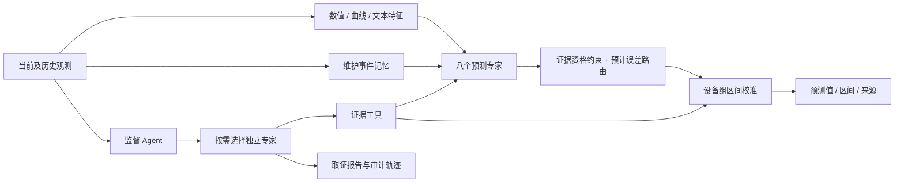
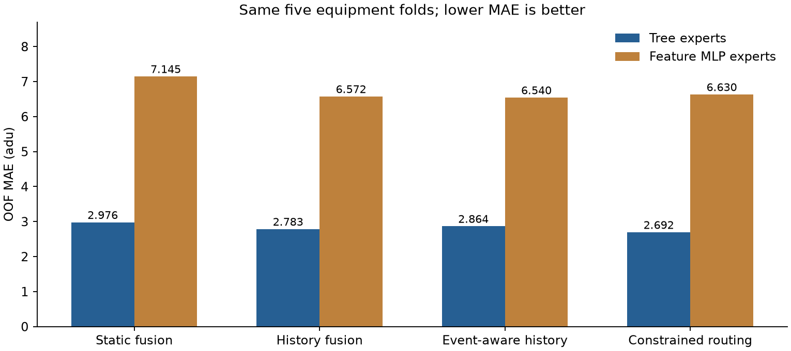

# MERA-PHM

### 维护感知的多模态退化预测与多 Agent 证据协作

[English](README.md) · [简体中文](README.zh-CN.md) · [实验总览](experiments/README.md) · [研究原理](docs/research-design.md)

[](https://github.com/13536309143/mera-phm/actions/workflows/ci.yml) · MIT · Python 3.12+

**给定设备当前的数值记录、曲线图像、巡检文本和维护历史，预测下一次计划巡检的退化水平，并提供预测区间、证据来源及 Agent 协作记录。**

MERA-PHM 的核心思路是：维护会改变历史证据的有效性，融合策略应随证据状态调整。项目将可训练的预测专家、维护事件记忆、证据路由和大模型工具协作连接成一条完整流程。默认使用 CPU 树模型，也提供支持 CUDA／MPS 的 PyTorch 神经网络后端。

## 1. 项目解决什么问题

工业巡检往往存在三类困难：图像或文本并非每次都采集；维修前的历史图像可能已经失效；不同模态在不同预测跨度下的可靠性不同。直接拼接全部信息，会把缺失或过时证据一起交给预测器。

本项目围绕“下一次巡检会退化到什么水平”构建完整流程：

| 输入 | 系统处理 | 输出 |
|---|---|---|
| 巡检跨度、距维修时间、清洗计数 | 数值分支 | 单模态预测 |
| 瞬态曲线图像 | 曲线几何与统计特征 | 当前图像证据 |
| 巡检记录 | TF-IDF 文本特征与原文取证 | 文本预测与解释依据 |
| 过去图像、维护事件、信息年龄 | 维护感知历史记忆 | 历史证据有效性 |
| 各分支预测与证据状态 | 学习路由、设备组校准 | 最终退化值与区间 |
| 上述工具结果 | 单／多 Agent 取证与审计 | 报告、协作轨迹、API 用量 |

一次预测会保存 `result.json` 和 `report.md`。退化水平使用 `adu`，时间使用 `atu`；目标是下一次计划巡检的水平。

## 2. 原理与设计重点



**维护感知记忆。** 根据距最近维修的时间，判断上一张图像是否来自维修之前；失效的旧图像退出维护后历史记忆。保留图像年龄和文本变化年龄，让路由器了解证据的新旧程度。

**按证据选择预测专家。** 数值、文本、图像、数值＋文本、数值＋图像、静态融合、普通历史、维护事件历史组成八个预测专家。路由器在独立设备上学习候选专家的预计误差，再从满足证据条件的专家中选择一个；缺失模态时有明确回退路径。

**预测区间与证据审计。** 用校准设备的整条轨迹最大残差构造 split conformal 区间。Agent 从受限工具取得模型预测、质量信息和训练档案案例，完成取证、融合和审计；结构化预测值由模型工具提供。

**两种训练后端。** `trees` 使用 ExtraTrees；`neural` 使用 PyTorch 特征 MLP。两者共用特征、设备划分、路由与校准协议，方便做同条件比较。神经专家可在 CPU、CUDA 或 MPS 上训练；路由器、特征预处理和区间校准使用 CPU。

## 3. 环境要求

| 运行环境 | 默认树模型 | 神经网络后端 |
|---|---|---|
| macOS，Apple Silicon | CPU | CPU / MPS |
| macOS，Intel | CPU | 按可用 PyTorch 构建配置 |
| Windows | CPU | CPU / NVIDIA CUDA |
| Linux | CPU | CPU / NVIDIA CUDA |

使用 **Python 3.12 或以上，建议 3.13**。普通部署安装基础依赖即可；API 模式需要支持 Chat Completions 工具调用的服务。大语言模型通过 API 调用，训练预测器使用本地计算资源。

CUDA 需要 NVIDIA 显卡、驱动和匹配的 PyTorch CUDA 构建。Apple Silicon 使用 MPS。安装版本由 [PyTorch 官方选择器](https://pytorch.org/get-started/locally/)确定；MPS 配置见 [官方说明](https://docs.pytorch.org/docs/stable/notes/mps.html)。

## 4. 安装与启动

```bash
git clone https://github.com/13536309143/mera-phm.git
cd mera-phm
```

### macOS / Linux

```bash
python3 -m venv .venv
source .venv/bin/activate
python -m pip install -e .
python main.py doctor
python main.py demo
python main.py serve --data data/demo --model artifacts/demo-model/model-bank.joblib --open
```

### Windows（命令提示符 / CMD）

```bat
py -3 -m venv .venv
.venv\Scripts\activate.bat
python -m pip install -e .
python main.py doctor
python main.py demo
python main.py serve --data data/demo --model artifacts/demo-model/model-bank.joblib --open
```

PowerShell 也可直接使用虚拟环境解释器，例如 `& .\.venv\Scripts\python.exe main.py doctor`。

浏览器打开 **http://127.0.0.1:8765**，选择设备、观测行、预测策略和编排模式。`demo` 生成示例数据并训练模型，便于快速体验整个流程。

也可以双击 Mac 的 `start-lab.command` 或 Windows 的 `start-lab.cmd`；启动器会创建环境并准备演示模型。`start-demo` 执行本地预测，`start-api` 执行 API 多 Agent 预测。所有 CLI 命令都可以用 `mera-phm` 替换 `python main.py`。

## 5. 配置 API

先复制配置模板：

```bash
# macOS / Linux
cp .env.example .env
```

```bat
rem Windows CMD
copy .env.example .env
```

填写 `.env`：

```dotenv
MODEL_API_KEY=your-api-key
MODEL_NAME=your-tool-calling-model
MODEL_BASE_URL=https://api.minimax.cn/v1
API_STYLE=chat
# 可选；服务不支持时删除这一行
MODEL_REASONING_EFFORT=low
```

MiniMax 可填自己的订阅 Key、模型名和兼容接口地址；公开 Agent 实验使用的模型名记在实验协议中。其他兼容服务修改相应字段即可。`doctor` 检查配置状态，隐藏密钥，不产生 API 请求。

```bash
python main.py doctor
python main.py predict --data data/demo --model artifacts/demo-model/model-bank.joblib --equipment 2 --row 8 --mode api
```

| `--mode` | 行为 | API 请求 |
|---|---|---|
| `local` | 本地模型＋确定性证据流程 | 无 |
| `single` | 一个 Agent 上下文完成取证与审计 | 有 |
| `api` | 监督 Agent 按需委派独立专家 | 有 |

多 Agent 提供质量、数值、视觉、文本、维护、检索、不确定性、审计八类专家，由监督 Agent 按样本选择。每个预测会话最多 12 次请求、每请求最多 4,096 生成 token、累计生成预算 24,000 token；输入 token 另计。成功的多 Agent 结果可以命中本地缓存。

## 6. 准备数据与训练

把数据集放在 `data/raw/Multimodal data for prognostics/`，其中包含 `1` 至 `50` 的设备目录。已有数据也可以通过 `--data` 指定，或在 `.env` 设置 `DATASET_PATH`。Windows 路径建议写成 `D:/datasets/Multimodal data for prognostics`。

数据字段、目录和原论文引用见 [数据说明](docs/dataset.md)。

### 默认 CPU 树模型

```bash
python main.py audit --data "data/raw/Multimodal data for prognostics"
python main.py train --data "data/raw/Multimodal data for prognostics" --backend trees --output artifacts/my-model
python main.py predict --data "data/raw/Multimodal data for prognostics" --model artifacts/my-model/model-bank.joblib --equipment 2 --row 100 --mode local
python main.py serve --data "data/raw/Multimodal data for prognostics" --model artifacts/my-model/model-bank.joblib --open
```

训练目录包含模型、测试指标、校准信息和报告。省略 `--output` 时自动生成带时间戳的模型目录。

### PyTorch 神经网络与 GPU

Apple Silicon Mac，或 Windows / Linux 的 CPU 环境，安装可选依赖：

```bash
python -m pip install -e ".[neural]"
python main.py doctor
```

Windows / Linux 的 CUDA 环境先按 [PyTorch 安装选择器](https://pytorch.org/get-started/locally/)安装对应的 CUDA 构建，再安装 `.[neural]`。检查并训练：

```bash
python main.py doctor --device cuda
python main.py train --data "data/raw/Multimodal data for prognostics" --backend neural --device cuda --epochs 80 --output artifacts/neural-model
```

Apple Silicon 将 `--device cuda` 改为 `--device mps`；CPU 使用 `--device cpu`，自动选择使用 `--device auto`。保存的神经网络权重可在这些环境之间加载；报告记录实际训练设备。

## 7. 实验效果

### 数值预测

数据集包含 **50 台设备、7,626 条观测**。五折整设备验证中，每台设备测试一次；每折分为 **25 台专家训练 / 5 台路由训练 / 10 台校准 / 10 台测试**。神经与树模型采用相同划分。

| 方法 | OOF MAE ↓ | RMSE ↓ |
|---|---:|---:|
| 数值树模型 | 6.488 | 9.038 |
| 静态三模态树模型，25台训练 | 2.976 | 4.935 |
| 强静态树模型，30台训练 | 2.759 | 4.699 |
| **MERA 树模型路由** | **2.692** | **4.773** |
| 静态三模态 MLP | 7.145 | 11.934 |
| MERA MLP 路由 | 6.630 | 11.301 |

默认路由相对 25 台训练的静态融合，MAE 下降约 **9.5%**；相对训练标签预算匹配的强对照，下降约 **2.4%**。当前数据上树模型优于已测试的 MLP，因此作为默认后端。

图像全面中断时，静态融合 MAE 为 **17.155**，约束路由为 **3.998**；额外随机缺图时，路由 MAE 为 **6.257**，数值＋文本专家为 **3.998**。平均预测区间宽 **64.15 adu**，整设备覆盖率 **94%**。完整消融、七类压力条件和每折指标收录在[实验总览](experiments/README.md)。




### Agent 协作与成本

六类证据情境、24 个配对样本，共实测 **822,665 token、658 次请求**，包含独立文字筛查和八类专家工具测试。

| 模式 | 完成 / 尝试 | 实测 token |
|---|---:|---:|
| 本地流程 | 24 / 24 | 0 |
| 单 Agent | 22 / 24 | 208,038 |
| 多 Agent，默认预算 | 11 / 24 | 307,492 |
| 对多 Agent 失败样本独立增加预算重试 | 9 / 13 | 221,522 |

八类专家独立工具测试全部完成。单 Agent 在本次实验中更省 token、完成率更高；多 Agent 的价值与改进重点在证据分工、过程追踪和编排稳定性。完整记录见 [Agent 实验](experiments/agents/paired-api/README.md)。

### 运行自己的实验

```bash
python main.py experiments
python main.py benchmark --data "data/raw/Multimodal data for prognostics" --backend trees --output artifacts/experiments/tree-run
python main.py benchmark --data "data/raw/Multimodal data for prognostics" --backend neural --device cuda --epochs 80 --output artifacts/experiments/neural-run
python main.py agent-benchmark --data "data/raw/Multimodal data for prognostics" --model artifacts/my-model/model-bank.joblib --output artifacts/experiments/api-run
```

数值实验不调用 API；`agent-benchmark` 会使用 `.env` 的服务配置。每个实验保存协议、分组、汇总指标和执行源码快照。已发表在仓库中的结果集中放在 `experiments/`，自己的运行默认放在 `artifacts/`。

## 8. 项目结构

```text
prognostics/
  data.py            因果数据读取与特征
  models.py          专家、路由、校准及保存
  neural.py          CPU / CUDA / MPS 神经后端
  agents.py          单／多 Agent 工具协作
  benchmark.py       五折预测与压力实验
  full_agent_benchmark.py  配对 API 实验
  cli.py / runtime.py     命令与环境检查
  server.py / web/         本地实验界面
experiments/
  numerical/         树模型与神经网络实验
  agents/            完整 Agent 对照
  archive/           早期试验
scripts/             启动器、图表与发布检查
tests/               数据、模型、Agent 与跨平台测试
docs/                原理和数据文档
data/                本地原始数据及生成的示例
artifacts/           本地模型和自己的实验
runs/                预测报告及缓存
```

## 9. 开发与引用

```bash
python -m pip install -r requirements-dev.txt
python -m unittest discover -s tests -v
ruff check prognostics tests scripts main.py
python scripts/check_release.py
```

CI 覆盖 macOS、Windows、Linux，并分别检查基础流程和可选神经后端。GPU 实机检查取决于运行机器的可用硬件。

项目围绕维护事件、证据有效性和可审计路由提供可复现实验；当前结果来自论文的模拟设备数据。数值预测改善与 Agent 编排分别评价，详细研究假设、对照、负结果和适用范围见 [研究设计](docs/research-design.md)。

代码及示例生成器采用 MIT 许可；原始数据需单独获取。使用数据请引用 [Yang、Baraldi、Zio 的论文](https://doi.org/10.1016/j.jmsy.2021.01.007)，软件引用见 [CITATION.cff](CITATION.cff)。贡献与配置说明见 [CONTRIBUTING.md](CONTRIBUTING.md)、[SECURITY.md](SECURITY.md)。
