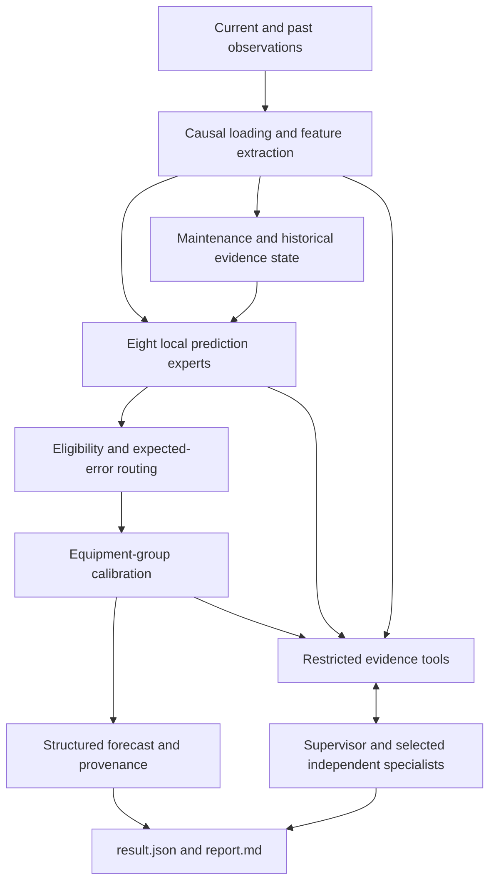

# MERA-PHM Technical Manual

## Maintenance-aware multimodal prognostics and auditable Agent collaboration

**Version: 1.1.0 · Updated: 2026-10-13 · [简体中文手册](technical-manual.zh-CN.md)**

MERA-PHM stands for *Maintenance-aware Evidence Routing for Agentic Prognostics*. It predicts equipment degradation at the **next scheduled inspection** from numerical records, curve images, inspection text and maintenance history. Each run provides a prediction, a calibrated interval, evidence provenance and an Agent trace.

This manual covers the implemented method, installation, configuration, training, inference, evaluation and extension. It is intended for learners, researchers reproducing the experiments, and developers adapting the system. Run commands from the repository root. The installed `mera-phm` command can replace `python main.py`.

### Reading guide

| Question | Chapters |
|---|---|
| What problem does the project solve? | 1–3 |
| How do features, memory, routing and intervals work? | 4–7 |
| How do Agents collaborate and use model outputs? | 8–9 |
| How do I install on Mac or Windows and use a GPU? | 10–11 |
| How do I configure the API, train and predict? | 12–14 |
| What do the experiments and paper comparison show? | 15–17 |
| How do I read outputs, use HTTP and troubleshoot? | 18–21 |
| How can I extend the research? | 22–24 |

## 1. Task and intended use

At observation time $t$, an equipment has numerical measurements, an image that may contain no visible curve, inspection text that may repeat an earlier record, and a history available up to $t$. Given the known horizon $h_t$ to its next scheduled inspection, predict:

$$
\widehat y_{t+h_t}=F(n_t,i_t,s_t,\mathcal H_{\le t},h_t).
$$

Here $n_t$ denotes numerical features, $i_t$ current image features, $s_t$ text features, and $\mathcal H_{\le t}$ current and past evidence. The supervised target $y_{t+h_t}$ is stored in `nextinslevel.txt` and used for offline training and evaluation.

Degradation is measured in arbitrary degradation units (`adu`); time uses arbitrary time units (`atu`). The target is an inspection degradation level. It is not remaining useful life, and the units do not directly represent days or percentages.

The system answers four practical questions: what degradation level to expect, how wide its interval is, which evidence combination to use, and which evidence is available, stale or affected by maintenance. Relevant research settings include intermittent inspections, missing modalities, obsolete pre-repair evidence and traceable equipment health forecasting. The current dataset contains simulated steam-generator degradation trajectories.

## 2. Technical position and mechanisms

The application connects two layers:

| Layer | Implementation | Responsibility |
|---|---|---|
| Numerical prediction | Local ExtraTrees or PyTorch feature MLPs | Learn degradation relationships, select an expert, calculate predictions and intervals |
| Agent collaboration | Tool-calling LLM API | Query evidence, delegate specialists, produce qualitative explanations, check workflow completion |

API mode uses the trained local predictor. A hosted LLM does not replace supervised training, and local deployment of a large language model is unnecessary.

The research mechanisms are:

1. **Maintenance-aware historical memory:** distinguish pre-repair images from evidence of the current equipment state.
2. **Evidence-constrained error routing:** check candidate eligibility, then select using learned expected errors.
3. **Freshness and disagreement inputs:** represent image age, text-change age and disagreement between candidate forecasts.
4. **Equipment-group intervals:** calibrate against maximum residuals over entire equipment trajectories.
5. **Independent, tool-grounded Agent contexts:** obtain numbers from model tools and retain evidence, provenance and usage.
6. **Separate evaluation of components:** measure regression quality, missing-modality robustness, coverage, Agent completion and token cost independently.

These mechanisms form a researchable technical design. Related-work analysis and controlled ablations are needed to establish novelty. Chapters 15–17 explain the evidence currently available.

## 3. Architecture and prediction lifecycle



One prediction proceeds as follows:

1. Load observations up to the requested equipment row and construct current features and historical state.
2. Obtain predictions from the eight trained experts.
3. Exclude ineligible candidates and select the lowest expected error; apply the missing-text fallback where required.
4. Apply the chosen policy's calibrated interval radius.
5. Run the deterministic evidence flow in `local`, or an LLM tool workflow in `single` or `api`.
6. Save the forecast, quality, completion state, model/sample identities, trace and usage.

The numerical forecast is computed before the LLM narrative. If the API workflow fails, the already computed local forecast can still be saved for inspection.

## 4. Data contract and temporal boundary

### 4.1 Directory layout

Place the paper dataset under `data/raw/Multimodal data for prognostics/`, or supply its location with `--data`. The root passed to the application directly contains equipment directories `1` through `50`:

```text
Multimodal data for prognostics/
  1/
    time.txt
    workorder.txt
    nextinslevel.txt
    Numerical/
      nextinstime.txt
      timefromlastrepair.txt
      Numberofchemicalcleaning.txt
      Numberofmechanicalcleaning.txt
    Image/
      1.tiff
      2.tiff
      ...
  ...
  50/
```

The current adapter reads 50 equipment trajectories and 7,626 observations. `--row` is **one-based**, and `{row}.tiff` is the corresponding image. Time, numerical channels, text and offline targets must align by row. Equipment time must be strictly increasing.

### 4.2 Numerical channels

| Position | File | Meaning |
|---:|---|---|
| 0 | `nextinstime.txt` | Horizon to the next scheduled inspection |
| 1 | `timefromlastrepair.txt` | Time elapsed since the latest repair |
| 2 | `Numberofchemicalcleaning.txt` | Chemical cleaning count |
| 3 | `Numberofmechanicalcleaning.txt` | Mechanical cleanings since the latest chemical cleaning |

`workorder.txt` contains one inspection record per row. Repeated text may be a carried-forward record; repetition alone does not establish a new measurement of the same condition.

### 4.3 Offline and online separation

`load_dataset()` returns observation dictionaries and a separate label array for training/evaluation. `online_sample()` constructs observations only up to the requested row. It does not open `nextinslevel.txt` or later image rows. Observation dictionaries have no `target` field.

Numerical files are read and then truncated to the requested row; the features and histories returned online stop at that row. The offline dataset fingerprint includes label files for training provenance and is not computed in the prediction endpoint.

Retrieval may expose **known outcomes in the training archive**. These are distinct from the query's future label: references come from expert-training equipment and exclude the current equipment.

## 5. Multimodal representations

### 5.1 Curve images: nine descriptors

The implementation extracts geometric and statistical curve features. Equipment `1/Image/1.tiff` supplies a fixed blank-axis template. A grayscale pixel is a curve mark when `image < 128` and `template >= 128`. The descriptor is:

| Index | Feature |
|---:|---|
| 0 | Visible-curve availability |
| 1 | Curve-pixel fraction of image area |
| 2–5 | Normalized vertical coordinate mean, standard deviation, minimum and maximum |
| 6 | Normalized horizontal extent |
| 7–8 | Normalized horizontal coordinate mean and standard deviation |

Coordinates are divided by image height minus one or width minus one. An image without detected curve pixels yields nine zeros. Dimensions must match the template. Changing the image template or axes requires adapting the extractor and retraining.

### 5.2 Text: TF-IDF

Text processing removes outer quotes, lowercases content and normalizes whitespace. TF-IDF uses unigrams/bigrams, `min_df=2` and at most 256 features. The vectorizer is fitted only on expert-training equipment and reused for all other partitions.

TF-IDF participates in regression. The text Agent consumes evidence returned by a tool. These roles are separate. A new language or industrial vocabulary requires checking vocabulary coverage and refitting.

### 5.3 Feature combinations

Let the fitted vocabulary size be $V\le256$:

| Expert | Inputs | Dimension |
|---|---|---:|
| `numeric` | Numerical | 4 |
| `text` | Text | $V$ |
| `image` | Current curve | 9 |
| `numeric_text` | Numerical + text | $4+V$ |
| `numeric_image` | Numerical + current curve | 13 |
| `static_fusion` | Numerical + current curve + text | $13+V$ |
| `history_fusion` | Static inputs + ordinary history | $26+V$ |
| `event_history` | Static inputs + maintenance-aware history | $26+V$ |

Multimodal learning does not require a multimodal foundation model. Here, feature fusion and supervised experts perform multimodal regression, while the LLM uses model and evidence tools.

## 6. Maintenance-aware historical memory

### 6.1 Thirteen-dimensional history

Ordinary history contains the last visible image's nine descriptors, image age, an image-history existence flag, a pre-repair-image flag, and text-change age:

$$
a_i=t-t_{\text{last visible image}},\qquad
a_s=t-t_{\text{last text change}}.
$$

When there is no image history, age is zero but the existence flag is also zero. Age alone must therefore not be interpreted as freshness. Text-change age is a proxy; a recent text change does not establish a recent repair.

Infer the latest repair time using the numerical record:

$$
t_{\text{repair}}=t-\text{timefromlastrepair},\qquad
b=\mathbb 1[t_{\text{last visible image}}<t_{\text{repair}}].
$$

If $b=1$, the first eleven event-history entries are zeroed, masking the old image, its age and its existence indicator. The pre-repair flag and text-change age remain. Ordinary history retains the original information for quality inspection and routing features.

### 6.2 Example: missing image after repair

Suppose the current time is 120 atu, the last visible image was at 90 atu, and the latest repair was 20 atu ago. The repair time is 100 atu. Since 90 precedes 100, that image is invalid as current post-repair history. If there is also no current curve, the event-history candidate is ineligible and the router must use other available evidence.

These numbers illustrate the rule. Actual selection depends on the learned errors and missing-modality rules.

## 7. Experts, error routing and calibrated intervals

### 7.1 Training backends

The default `trees` backend uses ExtraTrees experts with 100 trees, minimum leaf size 3, a fixed seed and two CPU workers. Demo training uses 20 trees for a quicker startup.

The optional `neural` backend uses:

```text
Input → Linear(64) → GELU → Linear(32) → GELU → Linear(1)
```

Input and target standardization use only expert-training data. Training uses float32, MSE loss, AdamW, learning rate 0.001, weight decay 0.001, batch size 512 and a default fixed 80 epochs. There is currently no early stopping or automatic hyperparameter search. Both backends share features, equipment partitions, routing and interval calibration.

### 7.2 Learning the router

Candidates are `numeric_text`, `static_fusion` and `event_history`. Experts fit on 25 equipment; another 5 equipment supply routing labels. On each routing observation, compute:

$$
e_k=|y-f_k(x)|.
$$

The gate learns $g(z)\approx(e_1,e_2,e_3)$. Its ten inputs are the four numerical channels, current-image availability, image age, pre-repair flag, text-change age, candidate prediction range and candidate prediction standard deviation.

The gate is a CPU ExtraTrees regressor with 80 trees, maximum depth 4 and minimum leaf size 30. Estimated errors are clipped below at zero. Selection is:

$$
k^*=\arg\min_{k\in\mathcal E(x)}g_k(z),\qquad \widehat y=f_{k^*}(x).
$$

This is constrained expert selection. The LLM does not score the experts, and the final forecast is not a simple average.

### 7.3 Eligibility and fallback

| Candidate | Eligibility |
|---|---|
| `numeric_text` | Always in the candidate table; empty text triggers an additional fallback |
| `static_fusion` | A visible current curve exists |
| `event_history` | Valid image history exists after maintenance masking |

For constrained routing, empty text falls back to `numeric_image` if a current curve exists, otherwise `numeric`. Direct `static_fusion`, `history_fusion` and `event_history` policies use their respective experts without the complete router constraints and are useful as controlled comparisons.

### 7.4 Prediction policies

| `--policy` | Behavior |
|---|---|
| `learned_router` | Default expected-error routing, eligibility and empty-text fallback |
| `static_fusion` | Direct static expert |
| `history_fusion` | Direct ordinary-history expert |
| `event_history` | Direct maintenance-aware expert |
| `missing_rule` | Static fusion when a current curve exists; numerical/text otherwise |
| `router_no_age` | Remove image/text ages from gate inputs |
| `router_no_event` | Remove repair time, cleaning counts and pre-repair flag from gate inputs |
| `router_unconstrained` | Full gate without eligibility or empty-text fallback |

`router_no_age` and `router_no_event` alter only the gate. Fully retrained ablations `router_without_freshness` and `router_without_reset` are produced by `benchmark` and are not `predict --policy` choices.

### 7.5 Equipment-group split-conformal intervals

Ten additional equipment calibrate the interval. Each equipment contributes its maximum absolute trajectory residual:

$$
S_j=\max_{r\in j}|y_r-\widehat y_r|.
$$

For nominal coverage $1-\alpha=0.9$, use order statistic
$\lceil(m+1)(1-\alpha)\rceil$. With $m=10$, this is the tenth score, the maximum $q$. The interval is $[\widehat y-q,\widehat y+q]$.

The coverage target concerns an entire new equipment trajectory under equipment-group exchangeability. This can produce wide intervals. Endpoints are not clipped to zero or another physical range. Distribution shifts require measuring coverage again; nominal 90% is not an exact probability of correctness for every individual forecast.

## 8. Agent roles and tool permissions

### 8.1 Role catalog

The eight prediction experts are supervised models. The eight specialist Agents are LLM responsibilities with independent contexts. They do not map one-to-one.

| Agent | Responsibility | Allowed evidence tools |
|---|---|---|
| Supervisor | Select specialists and advance the workflow | `delegate`, `inspect_quality`, `run_fusion`, `verify_forecast` |
| `quality` | Modality availability and freshness | `inspect_quality` |
| `numeric` | Numerical prediction evidence | `numeric_prediction` |
| `visual` | Curve descriptors and image quality | `visual_evidence`, `inspect_quality` |
| `text` | Inspection text evidence | `text_evidence` |
| `maintenance` | Repair events and historical validity | `maintenance_memory` |
| `retrieval` | Similar training references | `historical_cases` |
| `uncertainty` | Forecast and calibrated interval | `calibrated_forecast` |
| `audit` | Provenance, fusion state and label isolation | `audit_forecast` |

The Supervisor selects roles based on quality; it need not invoke every role. Delegation executes through tool calls. The experiment runner can process separate cases concurrently, but a session is not a concurrent discussion among all specialists.

### 8.2 Completion protocol

The multi-Agent workflow must inspect quality, complete at least two distinct predictive specialists, invoke fusion, audit it and produce a qualitative answer. Roles counted toward the two-specialist requirement are `numeric`, `visual`, `text`, `maintenance` and `retrieval`.

Each specialist must use at least one allowed evidence tool. Tool names and arguments are checked. Tools provide no arbitrary file reading, shell execution, key access or equipment-control capability.

### 8.3 Narrative versus structured results

Agents are prompted for short qualitative Chinese descriptions. The application removes `<think>` blocks and rejects empty text or Unicode decimal digits. Forecast values, horizons and intervals are rendered from `forecast` and a code-generated `verified_summary`.

This is a limited output check. It cannot catch every written-out number or semantic error. `agent_language_semantically_verified=false` records that distinction. Structured provenance checks also do not establish factual correctness of every narrative sentence.

This English manual describes the same implementation. Runtime Agent prompts and generated reports are primarily Chinese. Changing their language requires updating prompts, validation and evaluation together.

## 9. Modes, budgets and cache

| `--mode` | Workflow | API calls |
|---|---|---|
| `local` | Local predictor and deterministic evidence flow | None |
| `single` | One LLM context handles evidence and auditing | Yes |
| `api` | Supervisor delegates independent specialists | Yes |

A default prediction allows at most 12 API requests, up to 4,096 completion tokens per request, and 24,000 completion tokens per session. Prompt tokens are additional; 24,000 is not a total-token cap. Tool-loop limits are seven rounds for the Supervisor, three per specialist and nine for single Agent. Both loop limits and request budgets affect completion.

The SDK timeout is 120 seconds with no automatic retries. Accounting records attempts, successful responses and failed-call reservations. Missing provider usage is marked unknown and treated conservatively. Monetary cost depends on the provider's actual billing and pricing.

Successful `api` runs may be cached in `runs/agent-cache/`. The key includes the sample hash, model-file hash, policy, protocol version, API model and endpoint. Replay sets `cached=true` and `new_api_requests=0` while retaining original usage. `single` does not use this cache. Use `--no-cache` for a fresh multi-Agent call.

Use `local` for stable numerical batch outputs, `single` for a compact qualitative tool workflow, and `api` to study independent evidence responsibilities. Check completion and cost when evaluating API modes.

## 10. Environment and cross-platform installation

### 10.1 Requirements

| Component | Requirement |
|---|---|
| Python | 3.12+, preferably 3.13 |
| Default training | CPU; trees need neither PyTorch nor an API |
| Neural training | Optional PyTorch, constrained to `torch>=2.13,<2.15` |
| CUDA | NVIDIA GPU, compatible driver and CUDA-enabled PyTorch on Windows/Linux |
| MPS | A Mac supported by PyTorch MPS; project validation focuses on Apple Silicon |
| API | Chat Completions-compatible endpoint supporting tool calling |

Base dependencies are NumPy, SciPy, scikit-learn, Pillow, the OpenAI SDK, python-dotenv, Matplotlib and joblib. Versions are pinned in `pyproject.toml`.

Feature processing, trees, routing, calibration and retrieval use CPU. Only neural experts use a PyTorch device. `auto` prefers CUDA, then MPS, then CPU. A loaded neural checkpoint automatically selects the current inference device. There is no separate `predict --device` argument.

### 10.2 macOS / Linux

```bash
git clone https://github.com/13536309143/mera-phm.git
cd mera-phm
python3 -m venv .venv
source .venv/bin/activate
python -m pip install -e .
python main.py doctor
```

### 10.3 Windows CMD

```bat
git clone https://github.com/13536309143/mera-phm.git
cd mera-phm
py -3 -m venv .venv
.venv\Scripts\activate.bat
python -m pip install -e .
python main.py doctor
```

PowerShell can use the environment's interpreter directly without an activation script:

```powershell
py -3 -m venv .venv
& .\.venv\Scripts\python.exe -m pip install -e .
& .\.venv\Scripts\python.exe main.py doctor
```

Alternatively, double-click `start-lab.command` on Mac or `start-lab.cmd` on Windows. The launcher prepares the environment and demo model, then opens the local interface. `start-demo` runs a local prediction; `start-api` runs an API prediction after configuration.

### 10.4 Workspace and path resolution

Run from the repository root. By default, the current working directory is the workspace for `.env`, `data/`, `artifacts/` and `runs/`. To run elsewhere, set `MERA_WORKSPACE` to the repository and supply explicit data/model paths.

Data lookup precedence is: `--data` → process `DATASET_PATH` → workspace `.env` `DATASET_PATH` → default directory search. Forward-slash paths such as `D:/datasets/...` are convenient in Windows `.env` files.

## 11. PyTorch, CUDA and MPS

For CPU or Apple Silicon:

```bash
python -m pip install -e ".[neural]"
python main.py doctor
```

For CUDA on Windows/Linux, first install a compatible build using the [official PyTorch selector](https://pytorch.org/get-started/locally/), then install the optional project dependency. Confirm that the resulting torch version satisfies the project constraint; an older build may be replaced by dependency resolution.

```bash
python main.py doctor --device cuda
python main.py train --data "data/raw/Multimodal data for prognostics" --backend neural --device cuda --epochs 80 --output artifacts/cuda-model
```

On Apple Silicon:

```bash
python main.py doctor --device mps
python main.py train --data "data/raw/Multimodal data for prognostics" --backend neural --device mps --epochs 80 --output artifacts/mps-model
```

Use `--device cpu` without a GPU. `trees --device cuda` is unsupported. Neural weights are saved as CPU NumPy arrays and reconstructed on load, allowing movement across device environments. Reasonable floating-point differences may remain; bitwise identity is not promised.

Current validation covers Windows/Linux CPU and Mac CPU/MPS. The CUDA path and availability checks are implemented, but a full NVIDIA hardware benchmark has not yet been run. MPS linear layers use explicit matrix multiplication plus bias to pass checkpoint reload consistency checks in the tested environment. See [PyTorch MPS documentation](https://docs.pytorch.org/docs/stable/notes/mps.html) for platform requirements.

## 12. API configuration

Copy the template:

```bash
cp .env.example .env
```

Use `copy .env.example .env` in Windows CMD or `Copy-Item .env.example .env` in PowerShell. Configure:

```dotenv
MODEL_API_KEY=your-api-key
MODEL_NAME=your-tool-calling-model
MODEL_BASE_URL=https://api.minimax.cn/v1
API_STYLE=chat
MODEL_REASONING_EFFORT=low
# DATASET_PATH=D:/datasets/Multimodal data for prognostics
```

| Setting | Meaning |
|---|---|
| `MODEL_API_KEY` | Provider credential, kept locally or in private environment variables |
| `MODEL_NAME` | Authorized provider model identifier with tool support |
| `MODEL_BASE_URL` | Compatible SDK API base URL, rather than the provider console page |
| `API_STYLE` | Currently requires `chat` |
| `MODEL_REASONING_EFFORT` | Optional; remove if unsupported |
| `DATASET_PATH` | Optional default dataset root |

The MiniMax address is a configuration example. Actual subscription endpoints, model permissions and parameter support depend on the provider. The published Agent study used `MiniMax-M3.1-Flash-Preview`; other models may have different completion behavior.

Existing process variables take precedence over `.env`. `doctor` checks settings and devices without exposing the key or issuing API requests. Follow configuration checks with one `predict --mode single` or `api` to verify a live provider connection.

Git ignores `.env`. The browser calls the local Python server and does not receive the API key. Text and features supplied to the hosted tool workflow still pass through the provider API.

## 13. End-to-end operation

### 13.1 First run

```bash
python main.py demo
python main.py predict --data data/demo --model artifacts/demo-model/model-bank.joblib --equipment 2 --row 8 --mode local
python main.py serve --data data/demo --model artifacts/demo-model/model-bank.joblib --open
```

`demo` creates original small sample data and trains a demo model for learning the workflow. Use the paper dataset for research experiments.

### 13.2 Audit the paper dataset

```bash
python main.py audit --data "data/raw/Multimodal data for prognostics"
```

Check equipment count, observation count, target range, blank-curve rows and observation/label separation. Resolve missing files, misaligned rows, nonfinite values, nonmonotonic time or incompatible image dimensions before training.

### 13.3 Train trees

```bash
python main.py train --data "data/raw/Multimodal data for prognostics" --backend trees --seed 20261012 --output artifacts/my-model
```

This is one 25/5/10/10 equipment partition with evaluation on the last ten equipment. Outputs are `model-bank.joblib`, `results.json`, `held-out-predictions.json` and `report.md`. Run `benchmark` separately for five-fold evaluation.

Training, benchmark and prediction reports are stored in new directories to preserve previous runs. Choose a fresh output name or omit `--output` where timestamped defaults are available. Create demo data once, then predict or serve from it.

### 13.4 Local, single-Agent and multi-Agent inference

```bash
python main.py predict --data "data/raw/Multimodal data for prognostics" --model artifacts/my-model/model-bank.joblib --equipment 2 --row 100 --mode local
python main.py predict --data "data/raw/Multimodal data for prognostics" --model artifacts/my-model/model-bank.joblib --equipment 2 --row 100 --mode single
python main.py predict --data "data/raw/Multimodal data for prognostics" --model artifacts/my-model/model-bank.joblib --equipment 2 --row 100 --mode api --no-cache
```

Keep data, model, equipment, row and policy identical when comparing modes. The fixed predictor determines the regression output; Agent evaluation concerns evidence workflows, explanations, completion and cost.

### 13.5 Browser interface

```bash
python main.py serve --data "data/raw/Multimodal data for prognostics" --model artifacts/my-model/model-bank.joblib --port 8765 --open
```

Open `http://127.0.0.1:8765`. Select equipment, observation, policy and mode to inspect curves, modality status, expert predictions, intervals, reports and experimental summaries. Supply paired data/model paths. The server permits one running prediction job at a time.

## 14. Command reference

| Command | Purpose | Main arguments |
|---|---|---|
| `doctor` | Environment, API and device checks | `--device` |
| `experiments` | Published experiment index | None |
| `demo` | Generate and train demo data | `--data --output --seed --backend --device --epochs` |
| `audit` | Dataset audit | `--data --output` |
| `train` | One held-out training/evaluation run | `--data --output --seed --backend --device --epochs` |
| `predict` | Forecast one observation and write a report | `--data --model --equipment --row --mode --policy --output --no-cache` |
| `serve` | Local dashboard | `--data --model --port --open` |
| `benchmark` | Five equipment folds, baselines, ablations and stresses | `--data --output --seed --backend --device --epochs` |
| `agent-benchmark` | Stratified paired real API study | `--data --model --output --workers --max-tokens` |
| `research` | Tree holdout studies with 1–5 seeds | `--data --output --seeds` |
| `agent-control` | Compact comparison on 1–3 test equipment | `--data --model --output --cases --api` |

Use `--help` for any subcommand. `agent-control` uses row 100 and is intended for the paper dataset, not short demo trajectories. Multi-seed `research` and five-fold `benchmark` have different protocols and should remain separate results.

## 15. Numerical protocol and metrics

### 15.1 Five equipment folds

Every equipment appears in exactly one test fold, yielding 7,626 out-of-fold (OOF) predictions. Each fold uses:

| Partition | Equipment | Label use |
|---|---:|---|
| Expert training | 25 | Fit the vectorizer and supervised experts |
| Routing | 5 | Learn candidate absolute errors |
| Calibration | 10 | Calculate equipment-group residual quantiles |
| Test | 10 | Evaluate policies and intervals |

Equipment grouping prevents adjacent observations of the same equipment from appearing in training and test. A static ExtraTrees control fitted on 30 equipment controls for the router's additional five-equipment label budget.

### 15.2 Metrics

$$
\mathrm{MAE}=\frac1N\sum_r|y_r-\widehat y_r|,\qquad
\mathrm{MSE}=\frac1N\sum_r(y_r-\widehat y_r)^2,
$$

$$
\mathrm{RMSE}=\sqrt{\mathrm{MSE}},\qquad
\mathrm{MRE}=\frac{100}{N}\sum_r\frac{|y_r-\widehat y_r|}{\max(|y_r|,10^{-9})}.
$$

MAE and RMSE use adu; MSE uses adu². MRE is a percentage and can be sensitive near zero targets. Equipment-macro MAE averages each equipment's MAE equally. Pooled OOF MAE weights observations equally. A simple average of fold MAEs can also differ from pooled OOF MAE.

Intervals report mean width, row coverage and whole-equipment coverage. Whole-equipment coverage requires every observation of that test equipment to be covered.

Paired bootstrap resamples equipment 2,000 times and reports a descriptive 95% interval for macro-MAE improvement. Positive improvement favors the candidate. An interval crossing zero does not establish a stable advantage.

### 15.3 Reproduction

```bash
python main.py benchmark --data "data/raw/Multimodal data for prognostics" --backend trees --seed 20261012 --output artifacts/experiments/tree-manual-run
python main.py benchmark --data "data/raw/Multimodal data for prognostics" --backend neural --device cpu --epochs 80 --seed 20261012 --output artifacts/experiments/neural-manual-run
```

The benchmark saves its protocol, assignments, fold results, aggregates and execution-source snapshot. Change the neural `--device` for a GPU study while holding other settings fixed. Record hardware, dependencies, actual device and runtime as part of the comparison.

## 16. Current results and the original paper

### 16.1 Main results

| Method | OOF MAE ↓ | RMSE ↓ | MRE ↓ |
|---|---:|---:|---:|
| Numerical tree expert | 6.488 | 9.038 | 11.62% |
| Static tree fusion, 25 training equipment | 2.976 | 4.935 | 5.30% |
| Strong static ExtraTrees, 30 equipment | 2.759 | 4.699 | 4.82% |
| **MERA tree routing** | **2.692** | **4.773** | **4.84%** |
| Static feature MLP | 7.145 | 11.934 | 14.19% |
| MERA feature-MLP routing | 6.630 | 11.301 | 13.10% |

Tree routing reduces MAE by approximately 9.5% against 25-equipment static fusion and 2.4% against the 30-equipment strong control. The strong control has lower RMSE, so routing does not lead every metric. The equipment-bootstrap improvement interval against that control is approximately `[-0.190, 0.253]` adu, including zero.

Tree routing's mean interval width is approximately 64.15 adu, with 94% observed whole-equipment coverage. Consider width together with coverage. The tested fixed-configuration MLP is weaker than trees, so `trees` remains the default.

### 16.2 Ablations and stress tests

Fully retraining without freshness gives MAE 2.741; removing the repair-image reset gives 2.738. The equipment-level freshness improvement is approximately 0.047 adu with descriptive interval `[0.010, 0.081]`; the reset improvement is approximately 0.045 with interval `[-0.003, 0.094]`.

| Stress condition | Static tree fusion MAE | Constrained tree router MAE |
|---|---:|---:|
| Complete image outage | 17.155 | 3.998 |
| Complete text outage | 5.890 | 3.489 |
| Image and text outage | 22.795 | 6.488 |
| Invalid historical image | 17.155 | 3.998 |
| Additional 50% random image masking | 9.963 | 6.257 |
| Contiguous image outage | 7.650 | 3.473 |
| Curve-feature noise | 3.467 | 3.347 |

Under random image masking, numerical/text MAE is 3.998 and beats the router. Under curve noise, the strong static control achieves approximately 3.286 and also beats routing. These conditions motivate further study of routing under distribution shift.

### 16.3 Paper comparison

The source paper is *A multi-branch deep neural network model for failure prognostics based on multimodal data*, DOI [10.1016/j.jmsy.2021.01.007](https://doi.org/10.1016/j.jmsy.2021.01.007). Table 3 in the author-shared full text reports MAE 3.20, MSE 45.57 and MRE 6.76%.

| Result source | MAE ↓ | MSE ↓ | MRE ↓ |
|---|---:|---:|---:|
| Paper multi-branch DNN, published table | 3.200 | 45.570 | 6.76% |
| Project static tree fusion | 2.976 | 24.350 | 5.30% |
| Project tree router | 2.692 | 22.778 | 4.84% |
| Project MLP router | 6.630 | 127.722 | 13.10% |

The project's tree-router values are lower. However, the paper uses 40 development equipment and 10 test equipment per fold; this project separates expert fitting, routing and calibration. Exact author fold assignments have not been obtained. The paper uses image/text CNNs; this project uses curve descriptors, TF-IDF and trees or feature MLPs. This is a comparison of reported results under different protocols. A strict superiority claim requires implementing the paper network under matched splits and resources.

Source: [author-shared full text](https://www.researchgate.net/publication/349102644_A_multi-branch_deep_neural_network_model_for_failure_prognostics_based_on_multimodal_data). See the [experiment index](../experiments/README.md) for project records. Do not combine earlier single-holdout trials with the current five-fold aggregate.

## 17. Agent experiments and token cost

The formal paired study selects 24 unique equipment/row cases from model-held-out equipment across six quality strata: short-horizon visible curve, long-horizon visible curve, missing current curve with valid history, pre-repair history, no image history and stale text. Each stratum uses four distinct equipment; equipment can recur across strata.

Each case uses `local`, `single` and default-budget `api` with a fixed numerical model and no cache. Single/multi ordering alternates by case. Higher-request-budget rescue of multi-Agent failures is recorded separately.

| Mode | Completed / attempted | Requests | Recorded tokens | Mean time |
|---|---:|---:|---:|---:|
| Local control | 24 / 24 | 0 | 0 | No API |
| Single Agent | 22 / 24 | 117 | 208,038 | 9.07 s |
| Default multi-Agent | 11 / 24 | 272 | 307,492 | 25.75 s |
| Separate higher-budget rescue | 9 / 13 | 191 | 221,522 | 24.66 s |

Including eight specialist smoke tests and independent language screening, the formal study used 658 requests and 822,665 tokens. All 85 mode/rescue runs preserved the structured prediction and interval. All eight role smoke tests completed.

Single Agent completes more often with lower usage in this study. Multi-Agent provides divided evidence contexts, while its default workflow still needs reliability improvements. Independent language screening is model-assisted and has no human gold labels; flagged outputs are not an adjudicated error rate.

```bash
python main.py agent-benchmark --data "data/raw/Multimodal data for prognostics" --model artifacts/my-model/model-bank.joblib --workers 3 --max-tokens 2000000 --output artifacts/experiments/api-manual-run
```

This command includes paired modes, separate rescue, role tests and language screening and makes real API calls. `--max-tokens` controls a conservative aggregate admission budget, estimated with serialized UTF-8 prompt bytes and reservations and reconciled with actual usage. It is not an exact provider-tokenizer cap or a currency limit. Unknown usage prevents additional admission.

Published records describe existing trials. Refactoring preserves protocol meaning, but source snapshots and execution environments identify the implementation actually evaluated. See the [paired API study](../experiments/agents/paired-api/README.md).

## 18. Artifacts and result fields

### 18.1 Files

| Location | Contents |
|---|---|
| `artifacts/<model>/model-bank.joblib` | Experts, vectorizer, gates, radii, training references and manifest |
| `artifacts/<model>/results.json` | Holdout metrics, stresses, calibration and assignments |
| `artifacts/<model>/held-out-predictions.json` | Offline test labels and policy predictions |
| `runs/prediction-*/result.json` | Online forecast and full execution record |
| `runs/prediction-*/report.md` | Readable report |
| `runs/agent-cache/` | Successful multi-Agent cache |
| `experiments/numerical/` | Published tree/MLP grouped studies |
| `experiments/agents/` | Published real API study |
| `experiments/archive/` | Earlier pilot studies |

### 18.2 Important `result.json` fields

| Field | Interpretation |
|---|---|
| `mode` | Requested workflow |
| `agent_completion` / `error` | Workflow completion and failure reason |
| `forecast.prediction_adu` | Final local model prediction |
| `forecast.selected_expert` | Expert used for this forecast |
| `forecast.expert_predictions` | Eight expert outputs |
| `forecast.router_expected_errors` | Gate-estimated candidate errors, not observed query errors |
| `forecast.eligible_candidates` | Eligibility of the three routing candidates |
| `forecast.interval_adu` | Policy-calibrated interval endpoints |
| `forecast.horizon_atu` | Scheduled inspection horizon |
| `forecast.quality` | Modality, age and maintenance state |
| `forecast.label_used_in_inference` | Future-label access indicator; normally `false` |
| `verified_summary` | Code-generated structured summary |
| `narrative` | Original Agent qualitative text |
| `trace` / `completed_specialists` | Tool events and completed roles |
| `usage` / `new_api_requests` | Recorded usage and new requests this run |
| `cached` | Cache replay indicator |
| `provenance` | Model hash, sample hash and protocol version |
| `agent_language_semantically_verified` | Semantic fact-check status; normally `false` |

Read `forecast` first, then completion, quality and interval, followed by narrative. A prediction command returning exit code 1 may still have saved a valid local forecast; inspect `error` to identify the failing layer.

## 19. Local HTTP interface

The service binds to `127.0.0.1` and accepts valid local Host and same-origin requests. It is a local research interface without user authentication or public deployment infrastructure.

| Method | Path | Response |
|---|---|---|
| GET | `/api/overview` | Model, roles, policies and published experiment summaries |
| GET | `/api/equipments` | Equipment numbers, row counts and partition |
| GET | `/api/sample?equipment=2&row=100` | Causal observation and quality |
| GET | `/api/image?equipment=2&row=100` | Current TIFF rendered as PNG |
| POST | `/api/predict` | HTTP 202 with a job identifier |
| GET | `/api/jobs/{job}` | Job state and result |

Request example:

```json
{"equipment": 2, "row": 100, "mode": "local", "policy": "learned_router"}
```

Supported modes are `local`, `single` and `api`. JSON bodies are limited to 4,096 bytes. States are `running`, `completed` and `failed`. A completed job still requires checking `result.agent_completion`. Restarting clears the in-memory job list while saved reports remain.

Standard-library client example:

```python
import json
import urllib.request

body = json.dumps({
    "equipment": 2, "row": 100,
    "mode": "local", "policy": "learned_router",
}).encode("utf-8")
request = urllib.request.Request(
    "http://127.0.0.1:8765/api/predict",
    data=body, headers={"Content-Type": "application/json"}, method="POST",
)
with urllib.request.urlopen(request) as response:
    job = json.load(response)["job"]
with urllib.request.urlopen(f"http://127.0.0.1:8765/api/jobs/{job}") as response:
    print(json.load(response))  # Query again later if still running.
```

## 20. Troubleshooting

| Symptom | Check first | Resolution |
|---|---|---|
| Python/install failure | Interpreter, environment, network, available wheels | Prefer Python 3.13 and pip from the active environment |
| Missing `1/time.txt` | Extra directory nesting | Point `--data` directly at the equipment root |
| No saved model | Model path and training status | Run `train` or `demo` first |
| Row out of range | Actual equipment trajectory length | Use row 8 for demo; inspect paper equipment before row 100 |
| Output directory exists | Reused experiment path | Choose a new directory or timestamped default |
| CUDA unavailable | Driver, CUDA-enabled torch and GPU visibility | Check `doctor --device cuda`, or use CPU |
| MPS unavailable | Supported Mac/PyTorch | Check `doctor --device mps`, or use CPU |
| API HTTP 401/403 | Key, permissions and base URL | Correct local settings and stale process variables |
| API HTTP 400 | Tool/reasoning/request-field compatibility | Remove unsupported `MODEL_REASONING_EFFORT`; use a compatible model |
| API 429/timeout/service error | Provider limits, network and concurrency | Reduce benchmark `--workers`, verify service, then rerun |
| Tool-loop exhaustion | Rejected text, excessive calls, model protocol behavior | Inspect trace; compare single mode; improve protocol if needed |
| Negative interval lower bound | Large radius and unclipped interval | Interpret the statistical interval; clipping requires coverage reevaluation |
| UI reports a running task | Existing unfinished prediction | Wait for completion before submitting |
| Missing UI overview | Paired paths and adjacent `results.json` | Serve with explicit `--data` and `--model` |

API diagnostics expose status codes or exception types. Keep real credentials out of reports and commits when troubleshooting.

## 21. Operations, checks and data management

Manage models and configuration together with their protocol. Changes to features, prompts, assignments or parameters require a new experiment directory. Preserve manifests, hashes, execution snapshots and environment records.

`joblib` model loading is executable deserialization: load model files only from trusted sources. Workspace `.env`, raw data, models and local traces are local materials and are ignored by Git.

```bash
python -m unittest discover -s tests -v
python scripts/check_release.py
```

Tests cover causal loading, label isolation, eligibility, intervals, Agent protocol, budgets, neural checkpoint reload, launch portability and encoding. Optional hardware tests skip when unavailable; a skip is not hardware validation. Release CI has verified Windows/Linux/Mac; inspect the relevant run after subsequent changes.

Published studies include aggregates and protocols. Raw curves, inspection text, targets, model archives and per-observation records require separate management under their data permissions. Project code is MIT licensed; data rights follow the source dataset.

## 22. Extension guide

### 22.1 A new dataset

Adapt `data.py` to produce the same observation contract for numerical, image, historical and text inputs. The current adapter assumes 50 equipment. New equipment counts, sampling, repair semantics and units require explicit changes to loading, research partitions and interface enumeration. Verify alignment and future-information isolation first.

### 22.2 New image or text encoders

CNN/ViT image encoders or pretrained text encoders can replace descriptors or TF-IDF. Update `features()` and the training/persistence contract. Fit learned representations, vocabulary and normalization only with training data. Retain tree baselines and distinguish representation, backend and routing contributions.

### 22.3 New experts or Agents

New regression experts require changes to `EXPERTS`, feature combinations, routing candidates and calibration. New Agents require a role, restricted tools, completion rules, usage attribution and role tests. More roles alone do not improve numerical accuracy.

### 22.4 Further research

Useful directions include a matched original-paper CNN control, routing training for random/contiguous missing modalities, adaptive memory after maintenance, calibration balancing width and whole-equipment coverage, human-labeled Agent factual evaluation, external industrial data and actual CUDA benchmarking.

Turn each direction into a testable hypothesis with a fair control, metrics and failure criteria before implementation. This separates algorithmic, engineering and language contributions.

## 23. Current scope

The project includes the complete research workflow: data adaptation, features, experts, routing, calibration, API collaboration, a local interface and experimental records. Current results come from a previously explored simulated dataset. Independent real-industrial validation, exact paper reproduction and a world-first novelty claim have not been established. The measured multi-Agent contribution concerns divided evidence responsibilities and traceability; default-budget completion remains lower than single Agent.

These boundaries guide interpretation and further research. Before integrating the system into real equipment decisions, validate its data contract, errors, intervals and decision workflow for the target conditions.

## 24. Code reading, glossary and references

Suggested reading order: `data.py` → `models.py` → `research.py` / `benchmark.py` → `agents.py` / `budgets.py` → `cli.py` → `server.py`. Read `neural.py` for the PyTorch backend and `full_agent_benchmark.py` for the full API study.

| Term | Meaning |
|---|---|
| PHM | Prognostics and health management |
| Multimodal | Information in different forms, such as numerical, image and text |
| Expert model | Supervised predictor using a particular feature combination |
| Agent | LLM workflow with a task, context, tools and completion rules |
| Router / gate | Mechanism selecting a candidate prediction source |
| Maintenance-aware | Maintenance events affect features and evidence validity |
| OOF | Test-fold prediction for an equipment excluded from that fold's training |
| Calibration | Independent equipment residuals determine interval radius |
| Provenance | Traceable identity of models, samples, protocols and evidence |

References and further reading:

- [Project README](../README.md)
- [Dataset fields and attribution](dataset.md)
- [Research design](research-design.md)
- [Experiment index](../experiments/README.md)
- [Paper DOI](https://doi.org/10.1016/j.jmsy.2021.01.007) and [author-shared full text](https://www.researchgate.net/publication/349102644_A_multi-branch_deep_neural_network_model_for_failure_prognostics_based_on_multimodal_data)
- [PyTorch installation selector](https://pytorch.org/get-started/locally/) and [MPS documentation](https://docs.pytorch.org/docs/stable/notes/mps.html)

This manual describes the current implementation. To reproduce an existing study, use its own `protocol.json`, source snapshot and environment record.
