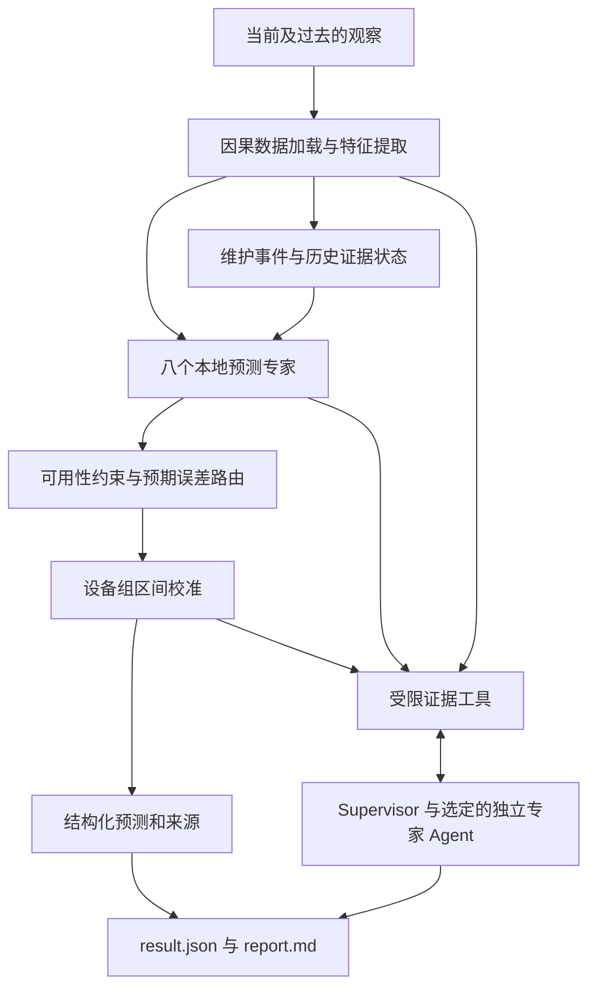

# MERA-PHM 技术手册

## 维护感知的多模态退化预测与可审计多 Agent 协作

**适用版本：1.1.0 · 更新日期：2026-10-13 · [English manual](technical-manual.md)**

MERA-PHM 的全称是 *Maintenance-aware Evidence Routing for Agentic Prognostics*。本项目研究如何从数值记录、曲线图像、巡检文本和维护历史中，预测设备在**下一次计划巡检时的退化水平**，并输出预测区间、证据来源和 Agent 协作记录。

这份手册面向第一次运行项目的学习者、希望复现实验的研究人员，以及准备扩展数据和模型的开发者。命令以仓库根目录为工作目录；`python main.py` 可以替换为安装后的 `mera-phm`。

### 阅读导航

| 你想解决的问题 | 对应章节 |
|---|---|
| 这个项目做什么、技术有什么特点？ | 1–3 |
| 多模态特征、维护记忆和路由怎样工作？ | 4–7 |
| Agent 怎样协作，哪些结果由谁产生？ | 8–9 |
| Mac / Windows / CUDA 怎样部署？ | 10–11 |
| 怎样配置 API、训练和预测？ | 12–14 |
| 实验效果如何，与原论文怎样比较？ | 15–17 |
| 怎样读取输出、接入程序、排查问题？ | 18–21 |
| 怎样扩展成自己的研究？ | 22–24 |

## 1. 任务定义与使用场景

在时刻 $t$，设备有一条数值记录、一张可能没有可见曲线的图像、一段可能沿用旧内容的巡检文本，以及截至当前时刻的历史。系统已知下一次计划巡检的时间跨度 $h_t$，需要预测其退化水平：

$$
\widehat y_{t+h_t}=F(n_t,i_t,s_t,\mathcal H_{\le t},h_t).
$$

其中，$n_t$ 是数值特征，$i_t$ 是当前曲线图像特征，$s_t$ 是文本特征，$\mathcal H_{\le t}$ 是当前及过去的证据。标签 $y_{t+h_t}$ 来自 `nextinslevel.txt`，用于离线训练与评估。

退化值使用 `adu`，时间使用 `atu`。它们分别是数据集定义的任意退化单位和任意时间单位。这里的预测目标不是剩余寿命 RUL，也没有直接转换成实际天数或百分比。

系统主要回答四个问题：下一次巡检的退化值是多少；预测区间有多宽；当前应该采用哪种模态组合；哪些证据可用、陈旧或已被维护事件影响。

适合的研究场景包括异步巡检、部分模态缺失、维修后旧证据失效，以及需要审计预测过程的多模态设备健康管理。当前数据来源是蒸汽发生器模拟退化轨迹。

## 2. 技术定位与关键机制

项目由两个相互连接的层组成：

| 层次 | 实现 | 主要职责 |
|---|---|---|
| 数值预测层 | 本地 ExtraTrees 或 PyTorch 特征 MLP | 学习退化关系，选择专家，计算预测值和区间 |
| Agent 协作层 | 兼容工具调用的 LLM API | 查询证据、委派专家、组织定性说明、检查流程 |

因此，API 模式仍使用已经训练好的本地预测模型。调用云端 LLM 不会代替监督模型训练，也不要求在电脑上部署大语言模型。

项目的研究机制集中在以下几个方面：

1. **维护感知的历史记忆**：区分维修前和维修后的图像证据，防止旧状态被直接沿用。
2. **证据约束的误差路由**：先判断候选专家能否使用，再根据学习到的误差选择专家。
3. **时效与分歧特征**：把图像年龄、文本变化年龄和专家间分歧作为路由输入。
4. **按设备校准的预测区间**：以一整条设备轨迹的最大残差作为校准分数。
5. **工具支撑的独立 Agent 协作**：数值来自模型工具，协作过程保留调用记录、来源与成本。
6. **分开的验证体系**：预测精度、缺模态鲁棒性、区间覆盖率、Agent 完成率与 token 成本分别评估。

这些机制构成可研究的技术方案。其新颖性应通过相关工作比较和消融实验继续论证；当前实验支持哪些机制有效，见第 15–17 章。

## 3. 系统架构与一次预测的过程



一次运行的顺序如下：

1. 根据设备号和行号加载截至该行的观察，构造当前特征与历史状态。
2. 八个本地专家分别给出预测。
3. 路由器屏蔽不符合证据条件的候选，选择预计误差较小的专家；缺文本时执行降级规则。
4. 使用该策略的校准半径生成预测区间。
5. `local` 模式组织确定性证据流；`single` 或 `api` 模式进一步调用 LLM 工具流程。
6. 保存预测、证据、完成状态、模型与样本指纹、调用记录和用量。

本地预测先于 LLM 说明生成。即使 API 流程失败，已计算的本地预测仍可保存供检查。

## 4. 数据契约与时间边界

### 4.1 数据目录

源代码仓库已附带完整论文数据：[数据压缩包](../data/raw/Multimodal%20data%20for%20prognostics.zip)。首次使用默认数据目录时会自动解压到 `data/raw/Multimodal data for prognostics/`，也可以运行 `python scripts/prepare_data.py --verify` 主动解压并逐文件验证。压缩包保留作者原始说明，数据指纹与已发布实验一致。其他位置的数据可通过 `--data` 指定。根目录直接包含 `1` 到 `50` 的设备目录：

```text
Multimodal data for prognostics/
  1/
    time.txt
    workorder.txt
    nextinslevel.txt
    Numerical/
      nextinstime.txt
      timefromlastrepair.txt
      Numberofchemicalcleaning.txt
      Numberofmechanicalcleaning.txt
    Image/
      1.tiff
      2.tiff
      ...
  ...
  50/
```

当前适配器读取 50 台设备、7,626 条观察。`--row` 从 **1** 开始，每行图像对应 `{row}.tiff`。同一设备的数值、文本、时间和标签按行对齐，时间必须严格递增。

### 4.2 四个数值通道

| 顺序 | 文件 | 含义 |
|---:|---|---|
| 0 | `nextinstime.txt` | 下一次计划巡检的时间跨度 |
| 1 | `timefromlastrepair.txt` | 距离最近维修的时间 |
| 2 | `Numberofchemicalcleaning.txt` | 化学清洗次数 |
| 3 | `Numberofmechanicalcleaning.txt` | 最近一次化学清洗后机械清洗次数 |

`workorder.txt` 每行是一条巡检文字。重复文字可能是前次记录被保留，不能直接解释为每次都重新采集到相同状态。

### 4.3 离线与在线分离

`load_dataset()` 在训练和评估阶段返回观察列表与独立标签数组。`online_sample()` 只构造截至指定行的观察，不打开 `nextinslevel.txt`，也不读取后续行图像。观察字典中没有 `target` 字段。

数值文件会被读取后截取到当前行；在线函数可见的特征与历史均截止当前行。离线数据集指纹包含标签文件，用于训练来源记录，不参与在线预测。

检索工具可以返回**训练档案中已知的历史结果**。这与访问当前查询样本的未来标签不同：检索仅使用模型训练设备档案，并排除当前设备。

## 5. 多模态特征表示

### 5.1 曲线图像：九维描述符

当前实现提取曲线几何与统计特征。设备 `1` 的 `Image/1.tiff` 作为固定空白坐标轴模板。灰度像素满足 `image < 128` 且 `template >= 128` 时视为曲线标记，随后计算：

| 索引 | 特征 |
|---:|---|
| 0 | 是否检测到可见曲线 |
| 1 | 曲线像素占图像面积的比例 |
| 2–5 | 归一化纵坐标均值、标准差、最小值、最大值 |
| 6 | 归一化横坐标跨度 |
| 7–8 | 归一化横坐标均值、标准差 |

横纵坐标分别除以图像宽度减一、图像高度减一。无曲线时九维向量全为零。图像尺寸必须与模板一致。该表示保留曲线形状线索；改变图像模板或坐标系后，应同步修改提取器并重新训练。

### 5.2 文本：TF-IDF

文本首先去除外层引号、转为小写并合并空白。向量器使用一元和二元词组、`min_df=2`、最多 256 个特征，只在专家训练设备上拟合。测试文本经过同一向量器转换。

TF-IDF 表示参与本地预测；文本 Agent 读取证据工具返回的文本信息。两者承担不同职责。直接迁移到新的语言或行业术语时，需要重新检查词表覆盖率。

### 5.3 特征组合维度

设实际 TF-IDF 词表维度为 $V\le256$：

| 专家 | 输入组合 | 维度 |
|---|---|---:|
| `numeric` | 数值 | 4 |
| `text` | 文本 | $V$ |
| `image` | 当前曲线 | 9 |
| `numeric_text` | 数值 + 文本 | $4+V$ |
| `numeric_image` | 数值 + 当前曲线 | 13 |
| `static_fusion` | 数值 + 当前曲线 + 文本 | $13+V$ |
| `history_fusion` | 静态组合 + 普通历史 | $26+V$ |
| `event_history` | 静态组合 + 维护感知历史 | $26+V$ |

多模态学习不局限于多模态大语言模型。这里通过特征融合和多个监督专家实现多模态回归；LLM 则通过工具使用这些模型与证据。

## 6. 维护感知历史记忆

### 6.1 十三维历史向量

普通历史包含：最近一次可见图像的九维描述符、图像年龄、是否存在图像历史、图像是否早于最近维修、文本变化年龄。

$$
a_i=t-t_{\text{last visible image}},\qquad
a_s=t-t_{\text{last text change}}.
$$

没有图像历史时，图像年龄记为零，但“是否存在图像历史”也为零，因此不能只看年龄判断证据新鲜。文本变化年龄是代理量；文字刚变化不能证明设备刚维修。

最近维修时间由数值记录推断：

$$
t_{\text{repair}}=t-\text{timefromlastrepair},\qquad
b=\mathbb 1[t_{\text{last visible image}}<t_{\text{repair}}].
$$

当 $b=1$ 时，事件历史向量前十一维清零，屏蔽维修前图像、其年龄和存在标记；保留维修前标记及文本变化年龄。普通历史仍保存原始信息，用于质量检查和路由特征。

### 6.2 示例：维修后的缺图记录

假设当前时刻为 120 atu，最近可见图像在 90 atu，最近维修距今 20 atu，则维修时刻为 100 atu。90 早于 100，因此该图像不能作为当前维修后的有效历史图像。当前也没有新曲线时，事件历史候选不符合条件，路由通常需要从其他可用证据中选择。

以上数字仅解释规则。实际选择由训练后的误差路由与缺失规则决定。

## 7. 本地专家、误差路由与校准区间

### 7.1 两种训练后端

默认 `trees` 专家为 ExtraTrees：100 棵树、叶节点最少 3 个样本、固定随机种子、两个 CPU 工作线程。演示模型使用 20 棵树以缩短启动时间。

可选 `neural` 专家为：

```text
输入 → Linear(64) → GELU → Linear(32) → GELU → Linear(1)
```

输入和目标均使用专家训练集的均值、标准差标准化；使用 float32、MSE 损失、AdamW、学习率 0.001、权重衰减 0.001、批大小 512，默认固定训练 80 个 epoch。当前没有早停或自动调参。树和神经网络后端共享特征、设备划分、路由和区间校准。

### 7.2 路由器怎样学习

路由候选是 `numeric_text`、`static_fusion`、`event_history`。专家在 25 台设备上训练，另 5 台设备提供路由训练标签。对于路由样本，构造每个候选的绝对误差：

$$
e_k=|y-f_k(x)|.
$$

门控模型学习 $g(z)\approx(e_1,e_2,e_3)$。输入 $z$ 共十维：四个数值通道、当前曲线可用标记、图像年龄、维修前标记、文本变化年龄、候选预测极差和标准差。

门控使用 80 棵 ExtraTrees、最大深度 4、最小叶样本数 30，在 CPU 上运行。预测误差被截断到非负值。最终采用：

$$
k^*=\arg\min_{k\in\mathcal E(x)}g_k(z),\qquad \widehat y=f_{k^*}(x).
$$

这是受约束的专家选择，而非让 LLM 给专家打分或把三种预测简单平均。

### 7.3 可用性与降级规则

| 候选 | 可用条件 |
|---|---|
| `numeric_text` | 路由候选表中始终允许；空文本再触发降级 |
| `static_fusion` | 当前图像有可见曲线 |
| `event_history` | 维护感知历史中存在有效图像 |

约束路由遇到空文本时，有当前曲线则返回 `numeric_image`，否则返回 `numeric`。直接选择 `static_fusion`、`history_fusion` 或 `event_history` 策略会使用对应专家，本身不执行完整路由约束，适合受控对照。

### 7.4 可选预测策略

| `--policy` | 行为 |
|---|---|
| `learned_router` | 默认：预期误差 + 可用性约束 + 空文本降级 |
| `static_fusion` | 直接使用静态融合专家 |
| `history_fusion` | 直接使用普通历史专家 |
| `event_history` | 直接使用维护感知历史专家 |
| `missing_rule` | 当前有曲线用静态融合，否则用数值/文本 |
| `router_no_age` | 门控输入移除图像年龄与文本变化年龄 |
| `router_no_event` | 门控输入移除维修时间、清洗次数、维修前标记 |
| `router_unconstrained` | 使用完整门控，不限制候选可用性，不执行空文本降级 |

`router_no_age`、`router_no_event` 只修改门控。完整重训消融 `router_without_freshness`、`router_without_reset` 在 `benchmark` 中产生，不能通过 `predict --policy` 直接选择。

### 7.5 设备组 split-conformal 区间

使用另 10 台设备校准。每台设备的分数为整条轨迹的最大绝对残差：

$$
S_j=\max_{r\in j}|y_r-\widehat y_r|.
$$

名义覆盖率为 $1-\alpha=0.9$，排序位置为
$\lceil(m+1)(1-\alpha)\rceil$。当 $m=10$ 时取第十个分数，即最大值 $q$，输出 $[\widehat y-q,\widehat y+q]$。

该区间以整条新设备轨迹为覆盖对象，依赖设备组交换性，通常比单点区间宽。区间端点不裁剪到零或其他物理范围。分布变化后需重新测量覆盖率，不能把名义 90% 解释为每个预测都拥有精确的 90% 正确概率。

## 8. 多 Agent 设计与工具权限

### 8.1 角色表

八个预测专家是监督模型；八个专业 Agent 是带独立对话上下文的 LLM 职责。名称相近不意味着一一对应。

| Agent | 主要职责 | 可调用证据工具 |
|---|---|---|
| Supervisor | 选择角色、推进流程、组织结论 | `delegate`、`inspect_quality`、`run_fusion`、`verify_forecast` |
| `quality` | 模态可用性与时效 | `inspect_quality` |
| `numeric` | 数值预测证据 | `numeric_prediction` |
| `visual` | 曲线描述符及图像质量 | `visual_evidence`、`inspect_quality` |
| `text` | 巡检文本证据 | `text_evidence` |
| `maintenance` | 维修事件与历史有效性 | `maintenance_memory` |
| `retrieval` | 相似训练档案 | `historical_cases` |
| `uncertainty` | 模型预测与校准区间 | `calibrated_forecast` |
| `audit` | 来源、融合状态与标签隔离检查 | `audit_forecast` |

Supervisor 根据当前质量选择专家，不要求每次使用全部角色。当前委派流程按工具调用执行，主实验可并行运行多个独立案例；它不是所有专家同时讨论的并发群聊。

### 8.2 完成条件

多 Agent 工作流须先检查质量，完成至少两位不同预测证据专家，再调用融合、审计，最后输出定性文字。参与“至少两位”计数的角色为 `numeric`、`visual`、`text`、`maintenance`、`retrieval`。

每个专业 Agent 至少调用一次自己的证据工具。其可用工具通过白名单限制，参数也会校验。当前工具没有任意文件访问、命令执行、密钥读取或设备控制权限。

### 8.3 说明文字与结构化结果

Agent 被要求输出简短中文定性说明。系统去除 `<think>` 块，拒绝空答案和 Unicode 十进制数字；数值、区间和跨度由代码生成的 `verified_summary` 与 `forecast` 展示。

这是一种有限的输出检查，不能识别所有中文数字表达或语义错误。`agent_language_semantically_verified=false` 保留了这一状态。结构化来源审计也不等同于对全部自然语言完成事实审查。

当前英文手册描述同一技术；运行时 Agent 提示和生成报告主要为中文。更换语言需要修改提示及对应的输出验证与实验。

## 9. 模式、调用预算与缓存

| `--mode` | 运行方式 | 是否调用 API |
|---|---|---|
| `local` | 本地模型与确定性证据流 | 否 |
| `single` | 一个 LLM 上下文处理证据和审计 | 是 |
| `api` | Supervisor 委派独立专业 Agent | 是 |

单次预测默认最多 12 次 API 请求，每次最多 4,096 completion tokens，整个会话最多 24,000 completion tokens。prompt tokens 另计，不能把 24,000 当作总 token 上限。Supervisor 最多七轮、专业 Agent 最多三轮、single 最多九轮工具循环，循环限制和请求预算共同影响完成率。

SDK 超时为 120 秒，不自动重试。用量包括请求尝试、成功响应和失败预留；若供应商没有返回用量，系统保守记账并标记未知。金额需按供应商实际账单和价格计算。

成功的 `api` 结果可缓存在 `runs/agent-cache/`。缓存键包含样本指纹、模型文件指纹、策略、协议版本、API 模型名和端点。重放时 `cached=true`、`new_api_requests=0`，但保留原始调用的 usage。`single` 不使用这套缓存；`--no-cache` 可用于多 Agent 新调用。

需要稳定批量输出预测值时可选 `local`。需要定性工具说明时可选 `single`。研究职责分工和独立证据流时再使用 `api`，并检查其完成状态与成本。

## 10. 环境与跨平台部署

### 10.1 环境要求

| 项目 | 要求 |
|---|---|
| Python | 3.12+，推荐 3.13 |
| 默认训练 | CPU；无 PyTorch 和 API 也可训练树模型 |
| 神经网络训练 | 可选 PyTorch，项目约束 `torch>=2.13,<2.15` |
| CUDA | Windows/Linux 的 NVIDIA GPU、兼容驱动与 CUDA 版 PyTorch |
| MPS | 受 PyTorch MPS 支持的 Mac，项目主要验证 Apple Silicon |
| API | Chat Completions 兼容端点，支持工具调用 |

基础依赖包括 NumPy、SciPy、scikit-learn、Pillow、OpenAI SDK、python-dotenv、Matplotlib 和 joblib，版本在 `pyproject.toml` 固定。

特征处理、树专家、路由、校准和检索使用 CPU；只有 `neural` 专家训练和推理使用 PyTorch 设备。`auto` 优先 CUDA，其次 MPS，最后 CPU。已保存神经模型加载后自动选择本机推理设备；`predict` 当前没有单独的 `--device` 参数。

### 10.2 macOS / Linux

```bash
git clone https://github.com/13536309143/mera-phm.git
cd mera-phm
python3 -m venv .venv
source .venv/bin/activate
python -m pip install -e .
python main.py doctor
```

### 10.3 Windows CMD

```bat
git clone https://github.com/13536309143/mera-phm.git
cd mera-phm
py -3 -m venv .venv
.venv\Scripts\activate.bat
python -m pip install -e .
python main.py doctor
```

PowerShell 可直接使用虚拟环境解释器，不依赖激活脚本：

```powershell
py -3 -m venv .venv
& .\.venv\Scripts\python.exe -m pip install -e .
& .\.venv\Scripts\python.exe main.py doctor
```

双击 `start-lab.command`（Mac）或 `start-lab.cmd`（Windows）可自动准备环境、演示模型并打开本地界面。`start-demo` 运行本地预测；`start-api` 运行 API 预测，需先配置密钥。

### 10.4 工作目录与配置位置

从仓库根目录运行。程序默认把当前工作目录作为工作区，读取其中的 `.env`、`data/`、`artifacts/`、`runs/`。从其他目录运行时，可将环境变量 `MERA_WORKSPACE` 设为仓库路径，并显式指定数据和模型。

数据路径优先级为：`--data` → 进程环境中的 `DATASET_PATH` → 工作区 `.env` 中的 `DATASET_PATH` → 默认数据目录搜索。Windows `.env` 中建议用 `D:/datasets/...` 风格路径。

## 11. PyTorch、CUDA 与 MPS

CPU 或 Apple Silicon 上安装可选后端：

```bash
python -m pip install -e ".[neural]"
python main.py doctor
```

Windows/Linux CUDA 环境先按 [PyTorch 官方安装选择器](https://pytorch.org/get-started/locally/) 选择适合硬件的构建，再安装项目可选依赖。确认安装后的 torch 仍满足项目版本约束；过旧构建可能被依赖解析器替换。

```bash
python main.py doctor --device cuda
python main.py train --data "data/raw/Multimodal data for prognostics" --backend neural --device cuda --epochs 80 --output artifacts/cuda-model
```

Apple Silicon 将上面设备参数换为 `mps`：

```bash
python main.py doctor --device mps
python main.py train --data "data/raw/Multimodal data for prognostics" --backend neural --device mps --epochs 80 --output artifacts/mps-model
```

没有 GPU 时使用 `--device cpu`。`trees --device cuda` 不受支持。神经权重保存为 CPU NumPy 数组，在加载时重建网络，因此可以在不同设备之间迁移。跨设备数值允许合理的浮点误差，不承诺逐位相同。

当前验证覆盖 Windows/Linux CPU 与 Mac CPU/MPS。CUDA 路径已经实现并检查可用性逻辑，尚未完成 NVIDIA 硬件上的完整基准。MPS 的线性层采用显式矩阵乘法加偏置，以通过当前环境的模型保存/重载一致性检查。MPS 环境说明见 [PyTorch 官方文档](https://docs.pytorch.org/docs/stable/notes/mps.html)。

## 12. API 配置

复制 `.env.example`：

```bash
cp .env.example .env
```

Windows CMD 使用 `copy .env.example .env`，PowerShell 使用 `Copy-Item .env.example .env`。填写：

```dotenv
MODEL_API_KEY=your-api-key
MODEL_NAME=your-tool-calling-model
MODEL_BASE_URL=https://api.minimax.cn/v1
API_STYLE=chat
MODEL_REASONING_EFFORT=low
# DATASET_PATH=D:/datasets/Multimodal data for prognostics
```

| 配置项 | 含义 |
|---|---|
| `MODEL_API_KEY` | 供应商密钥，只保存在本机或私有环境变量 |
| `MODEL_NAME` | 当前账户有权限使用、支持工具调用的模型标识 |
| `MODEL_BASE_URL` | SDK 使用的兼容端点基础地址，不是控制台网页 |
| `API_STYLE` | 当前实现要求 `chat` |
| `MODEL_REASONING_EFFORT` | 可选；供应商不支持时删除这一行 |
| `DATASET_PATH` | 可选默认数据路径 |

MiniMax 示例地址作为配置模板。订阅账户的实际模型权限、端点和参数支持以供应商配置为准。已发布 Agent 实验记录的模型为 `MiniMax-M3.1-Flash-Preview`，并不保证其他模型产生相同完成率。

已有进程环境变量优先于 `.env`；`doctor` 检查配置和设备，不发起 API 请求、不显示密钥。确认“已配置”后，再用一条 `predict --mode single` 或 `api` 验证供应商连接。

`.env` 已被 Git 忽略。浏览器界面只调用本地 Python 服务，密钥不会下发到前端；提供给云端工具流程的文本和特征仍会经过供应商 API。

## 13. 端到端操作

### 13.1 第一次体验

```bash
python main.py demo
python main.py predict --data data/demo --model artifacts/demo-model/model-bank.joblib --equipment 2 --row 8 --mode local
python main.py serve --data data/demo --model artifacts/demo-model/model-bank.joblib --open
```

`demo` 创建项目原创的小型演示数据并训练演示模型，用于熟悉流程。后续研究实验使用论文数据。

### 13.2 检查论文数据

```bash
python main.py audit --data "data/raw/Multimodal data for prognostics"
```

检查设备数、样本数、目标范围、空曲线行数及观察/标签分离状态。若缺文件、行数不齐、非有限数值、时间不递增或图像尺寸不匹配，先修复数据输入。

### 13.3 训练树模型

```bash
python main.py train --data "data/raw/Multimodal data for prognostics" --backend trees --seed 20261012 --output artifacts/my-model
```

一次训练使用 25/5/10/10 的设备划分，并在最后 10 台设备上评估。产物包括 `model-bank.joblib`、`results.json`、`held-out-predictions.json`、`report.md`。完整五折结果需要另外运行 `benchmark`。

训练、基准与预测报告使用新目录保存，避免覆盖已有研究结果；重复运行可省略支持自动命名的 `--output`，或改用新的实验目录。`demo` 的数据目录也需新建一次，随后直接预测或启动界面即可。

### 13.4 本地、单 Agent、多 Agent 预测

```bash
python main.py predict --data "data/raw/Multimodal data for prognostics" --model artifacts/my-model/model-bank.joblib --equipment 2 --row 100 --mode local
python main.py predict --data "data/raw/Multimodal data for prognostics" --model artifacts/my-model/model-bank.joblib --equipment 2 --row 100 --mode single
python main.py predict --data "data/raw/Multimodal data for prognostics" --model artifacts/my-model/model-bank.joblib --equipment 2 --row 100 --mode api --no-cache
```

为了比较三种模式，保持数据、模型、设备、行号和策略相同。回归输出由同一个模型决定；Agent 实验比较的是证据流程、说明、完成率和成本。

### 13.5 浏览器界面

```bash
python main.py serve --data "data/raw/Multimodal data for prognostics" --model artifacts/my-model/model-bank.joblib --port 8765 --open
```

打开 `http://127.0.0.1:8765`。选择设备、观察行、策略和模式后查看曲线、模态状态、专家预测、区间、运行报告和实验摘要。始终使用配套的数据与模型路径。服务一次只接受一个正在运行的预测任务。

## 14. 命令参考

| 命令 | 用途 | 主要参数 |
|---|---|---|
| `doctor` | 检查环境、配置、可选设备 | `--device` |
| `experiments` | 显示已发布实验索引 | 无 |
| `demo` | 生成并训练演示 | `--data --output --seed --backend --device --epochs` |
| `audit` | 数据检查 | `--data --output` |
| `train` | 单次设备留出训练与评估 | `--data --output --seed --backend --device --epochs` |
| `predict` | 单个观察的预测与报告 | `--data --model --equipment --row --mode --policy --output --no-cache` |
| `serve` | 本地界面 | `--data --model --port --open` |
| `benchmark` | 五设备折、基线、消融、压力实验 | `--data --output --seed --backend --device --epochs` |
| `agent-benchmark` | 分层配对真实 API 实验 | `--data --model --output --workers --max-tokens` |
| `research` | 1–5 个种子的树模型留出研究 | `--data --output --seeds` |
| `agent-control` | 1–3 个测试设备的简短模式对照 | `--data --model --output --cases --api` |

任何子命令可用 `--help` 查看。`agent-control` 固定使用第 100 行，适合论文数据，不适合只有少量行的演示数据。`research` 与五折 `benchmark` 是不同协议，结果应分别记录。

## 15. 数值实验协议与指标

### 15.1 五折按设备验证

每台设备只出现在一个测试折中，最终汇总 7,626 个 out-of-fold（OOF）预测。每折：

| 用途 | 设备数 | 使用标签的目的 |
|---|---:|---|
| 专家训练 | 25 | 拟合特征向量器和监督专家 |
| 路由训练 | 5 | 学习各候选的绝对误差 |
| 区间校准 | 10 | 计算每种策略的设备组残差分位数 |
| 测试 | 10 | 评估最终策略与区间 |

按设备划分避免同一设备相邻观察同时落入训练与测试。30 台设备训练的强静态 ExtraTrees 基线用于控制路由方案使用额外五台设备标签的影响。

### 15.2 指标

$$
\mathrm{MAE}=\frac1N\sum_r|y_r-\widehat y_r|,\qquad
\mathrm{MSE}=\frac1N\sum_r(y_r-\widehat y_r)^2,
$$

$$
\mathrm{RMSE}=\sqrt{\mathrm{MSE}},\qquad
\mathrm{MRE}=\frac{100}{N}\sum_r\frac{|y_r-\widehat y_r|}{\max(|y_r|,10^{-9})}.
$$

MAE、RMSE 单位为 adu，MSE 为 adu²。MRE 的单位是百分比，真实值接近零时会敏感。设备宏平均 MAE 先逐设备计算再平均，使长短轨迹具有同样权重。OOF MAE 则逐观察加权。五折 MAE 的简单均值也可能与 OOF MAE 不同。

区间同时报告平均宽度、逐行覆盖率和整台设备覆盖率。后者要求该设备每一条测试观察都被区间覆盖。

配对 bootstrap 在设备层面重采样 2,000 次，给出宏平均 MAE 改善的描述性 95% 区间。正改善表示候选优于对照；区间跨零时不能据此认为稳定优于对照。

### 15.3 可重复执行

```bash
python main.py benchmark --data "data/raw/Multimodal data for prognostics" --backend trees --seed 20261012 --output artifacts/experiments/tree-manual-run
python main.py benchmark --data "data/raw/Multimodal data for prognostics" --backend neural --device cpu --epochs 80 --seed 20261012 --output artifacts/experiments/neural-manual-run
```

基准记录协议、设备分配、各折结果、汇总和执行源码快照。GPU 运行可修改神经后端的 `--device`，保留其他设置进行比较；硬件、依赖版本、实际设备与运行时间也应记录。

## 16. 当前实验效果与原论文比较

### 16.1 主结果

| 方法 | OOF MAE ↓ | RMSE ↓ | MRE ↓ |
|---|---:|---:|---:|
| 数值树专家 | 6.488 | 9.038 | 11.62% |
| 静态树融合，25 台训练设备 | 2.976 | 4.935 | 5.30% |
| 强静态 ExtraTrees，30 台训练设备 | 2.759 | 4.699 | 4.82% |
| **MERA 树路由** | **2.692** | **4.773** | **4.84%** |
| 静态特征 MLP | 7.145 | 11.934 | 14.19% |
| MERA 特征 MLP 路由 | 6.630 | 11.301 | 13.10% |

树路由相对 25 设备静态融合的 MAE 下降约 9.5%，相对 30 设备强对照下降约 2.4%。强对照的 RMSE 更低；树路由没有在所有指标上领先。与强对照的设备 bootstrap 改善区间为约 `[-0.190, 0.253]` adu，包含零。

树路由区间平均宽度约 64.15 adu，实测整设备覆盖率 94%。覆盖较高同时区间较宽，使用时需要同时评价这两个量。当前固定配置的 MLP 弱于树模型，因此默认后端保留 `trees`。

### 16.2 消融与压力测试

完整重训移除时效特征后 MAE 为 2.741，移除维修图像重置后为 2.738。时效组件的设备级改善约 0.047 adu，描述性区间约 `[0.010, 0.081]`；维修重置改善约 0.045 adu，区间约 `[-0.003, 0.094]`。

| 压力条件 | 静态树融合 MAE | 约束树路由 MAE |
|---|---:|---:|
| 图像全中断 | 17.155 | 3.998 |
| 文本全中断 | 5.890 | 3.489 |
| 图像与文本均中断 | 22.795 | 6.488 |
| 历史图像失效 | 17.155 | 3.998 |
| 额外随机缺失 50% 图像 | 9.963 | 6.257 |
| 连续图像中断 | 7.650 | 3.473 |
| 曲线特征噪声 | 3.467 | 3.347 |

随机缺图条件下，数值/文本专家 MAE 3.998，优于路由；曲线噪声条件下，强静态对照约 3.286，也优于路由。这些结果提示需要进一步研究分布变化下的路由泛化。

### 16.3 与原论文对照

原论文为 *A multi-branch deep neural network model for failure prognostics based on multimodal data*，DOI：[10.1016/j.jmsy.2021.01.007](https://doi.org/10.1016/j.jmsy.2021.01.007)。作者公开全文的 Table 3 报告：MAE 3.20、MSE 45.57、MRE 6.76%。

| 结果来源 | MAE ↓ | MSE ↓ | MRE ↓ |
|---|---:|---:|---:|
| 论文多分支 DNN，公开表格 | 3.200 | 45.570 | 6.76% |
| 本项目静态树融合 | 2.976 | 24.350 | 5.30% |
| 本项目树路由 | 2.692 | 22.778 | 4.84% |
| 本项目 MLP 路由 | 6.630 | 127.722 | 13.10% |

公开数值上，树路由更低。但论文每折使用 40 台开发设备、10 台测试设备；本项目拆分专家、路由、校准与测试，且尚未取得作者完全相同的折分。论文使用图像/文本 CNN，本项目使用曲线描述符、TF-IDF 与树或特征 MLP。因此这张表是**不同协议的公开结果对照**；要建立严格的优越性结论，还需在相同划分和训练资源下实现论文网络并对照。

论文全文来源：[作者公开全文](https://www.researchgate.net/publication/349102644_A_multi-branch_deep_neural_network_model_for_failure_prognostics_based_on_multimodal_data)。完整本项目结果见 [实验索引](../experiments/README.md)，不要将早期单次留出结果混入当前五折汇总。

## 17. Agent 实验、效果与 token 成本

正式配对研究从模型测试设备中，按六种质量场景选取 24 个唯一设备/行样本：短跨度可见曲线、长跨度可见曲线、当前缺图但历史有效、历史图像早于维修、没有图像历史、文本长期未变。每种场景选四台不同设备，不同场景可以共享设备。

相同样本分别运行 `local`、`single` 和默认预算 `api`，保持本地模型固定、禁用缓存；单 Agent 与多 Agent 顺序交替。多 Agent 默认失败案例的更高请求预算重试单独统计。

| 模式 | 完成 / 尝试 | 请求数 | 记录 token | 平均耗时 |
|---|---:|---:|---:|---:|
| 本地对照 | 24 / 24 | 0 | 0 | 不含 API |
| 单 Agent | 22 / 24 | 117 | 208,038 | 9.07 s |
| 默认预算多 Agent | 11 / 24 | 272 | 307,492 | 25.75 s |
| 独立较高预算补救 | 9 / 13 | 191 | 221,522 | 24.66 s |

加上八个专业角色 smoke test 与独立语言筛查，正式研究共 658 次请求、822,665 token。所有 85 次模式/补救运行的结构化预测与区间保持一致。八个专业角色 smoke test 全部完成。

这说明当前单 Agent 更省调用且完成率更高；多 Agent 提供可分工的证据上下文，但默认流程仍需改进。独立语言筛查是模型辅助审查，没有人工金标准，不能把筛查标记直接当作准确的错误率。

```bash
python main.py agent-benchmark --data "data/raw/Multimodal data for prognostics" --model artifacts/my-model/model-bank.joblib --workers 3 --max-tokens 2000000 --output artifacts/experiments/api-manual-run
```

该命令包含配对模式、独立补救、角色测试与语言筛查，会调用真实 API。`--max-tokens` 是实验总体保守准入预算：以序列化提示的 UTF-8 字节数加预留估算，并结合实际 usage 结算，不是供应商 tokenizer 的精确硬上限，也不是金额上限。未知用量会阻止继续准入。

已发布记录属于既有实验；重构后的版本保持协议含义，但源码快照与运行环境决定实际实验来源。详情见 [配对 API 实验](../experiments/agents/paired-api/README.md)。

## 18. 产物与结果字段

### 18.1 文件位置

| 位置 | 内容 |
|---|---|
| `artifacts/<model>/model-bank.joblib` | 专家、向量器、门控、区间半径、训练检索档案、manifest |
| `artifacts/<model>/results.json` | 单次训练指标、压力结果、校准与划分 |
| `artifacts/<model>/held-out-predictions.json` | 单次测试观察的真实标签和策略预测，离线使用 |
| `runs/prediction-*/result.json` | 单次在线预测与完整执行记录 |
| `runs/prediction-*/report.md` | 可阅读报告 |
| `runs/agent-cache/` | 成功多 Agent 缓存 |
| `experiments/numerical/` | 已发布树 / MLP 五折研究 |
| `experiments/agents/` | 已发布真实 API 配对研究 |
| `experiments/archive/` | 早期试验 |

### 18.2 `result.json` 核心字段

| 字段 | 怎样解释 |
|---|---|
| `mode` | 本次请求模式 |
| `agent_completion` / `error` | Agent 流程是否完成及失败原因 |
| `forecast.prediction_adu` | 本地模型最终预测值 |
| `forecast.selected_expert` | 本次实际使用的专家 |
| `forecast.expert_predictions` | 八个专家预测 |
| `forecast.router_expected_errors` | 门控估计的候选误差，非真实当前误差 |
| `forecast.eligible_candidates` | 三个路由候选的可用状态 |
| `forecast.interval_adu` | 该策略校准区间端点 |
| `forecast.horizon_atu` | 下一次巡检跨度 |
| `forecast.quality` | 当前模态、年龄、维修状态 |
| `forecast.label_used_in_inference` | 在线流程是否使用未来标签，正常为 `false` |
| `verified_summary` | 从结构化结果生成的摘要 |
| `narrative` | Agent 原始定性文字 |
| `trace` / `completed_specialists` | 工具事件与已完成角色 |
| `usage` / `new_api_requests` | 已记录用量与本次新增请求 |
| `cached` | 是否重放缓存 |
| `provenance` | 模型指纹、样本指纹、协议版本 |
| `agent_language_semantically_verified` | 当前语言是否已完成语义事实核验，正常为 `false` |

读取结果时先看 `forecast`，再看完成状态、质量和区间，最后看文字说明。API 预测退出码为 1 时，输出目录可能仍包含有效的本地模型预测，应通过 `error` 判断是哪一层失败。

## 19. 本地 HTTP 接口

服务绑定 `127.0.0.1`，仅接受本地合法 Host 和同源请求。当前用于本机研究界面，无用户登录或公网服务部署机制。

| 方法 | 路径 | 内容 |
|---|---|---|
| GET | `/api/overview` | 模型、角色、策略与已发布实验摘要 |
| GET | `/api/equipments` | 设备号、行数、训练划分 |
| GET | `/api/sample?equipment=2&row=100` | 因果观察与质量 |
| GET | `/api/image?equipment=2&row=100` | 当前 TIFF 的 PNG 展示 |
| POST | `/api/predict` | 提交预测任务，返回 HTTP 202 与 job 标识 |
| GET | `/api/jobs/{job}` | 查询运行状态与结果 |

请求示例：

```json
{"equipment": 2, "row": 100, "mode": "local", "policy": "learned_router"}
```

支持 `local`、`single`、`api`。请求 JSON 大小最多 4,096 字节。任务状态为 `running`、`completed` 或 `failed`；`completed` 表示后台任务返回，仍应检查 `result.agent_completion`。内存任务列表在重启后清空，已保存报告继续存在。

以下 Python 示例使用标准库，不需要额外 HTTP 依赖：

```python
import json
import urllib.request

body = json.dumps({
    "equipment": 2, "row": 100,
    "mode": "local", "policy": "learned_router",
}).encode("utf-8")
request = urllib.request.Request(
    "http://127.0.0.1:8765/api/predict",
    data=body, headers={"Content-Type": "application/json"}, method="POST",
)
with urllib.request.urlopen(request) as response:
    job = json.load(response)["job"]
with urllib.request.urlopen(f"http://127.0.0.1:8765/api/jobs/{job}") as response:
    print(json.load(response))  # 若仍 running，稍后再次查询
```

## 20. 故障排查

| 表现 | 优先检查 | 处理方式 |
|---|---|---|
| Python 或安装失败 | 解释器版本、虚拟环境、网络、依赖轮子 | 使用 Python 3.13，确认 pip 属于当前环境 |
| 找不到 `1/time.txt` | 数据根目录是否多包了一层 | `--data` 指向直接包含设备目录的位置 |
| 尚无训练模型 | `--model` 文件及训练状态 | 先运行 `train` 或 `demo` |
| 行号超出范围 | 当前设备真实行数 | 演示使用第 8 行；论文设备检查后再选第 100 行 |
| 输出目录已经存在 | 是否复用已有实验路径 | 改用新目录或自动命名 |
| CUDA 不可用 | NVIDIA 驱动、CUDA torch 构建、设备可见性 | 检查 `doctor --device cuda`，必要时改 CPU |
| MPS 不可用 | Mac/PyTorch 是否支持 MPS | 检查 `doctor --device mps`，必要时改 CPU |
| API HTTP 401/403 | 密钥、模型权限、基础地址 | 更新本机配置并确认终端环境没有旧值 |
| API HTTP 400 | 工具调用、reasoning 参数、请求字段支持 | 删除不支持的 `MODEL_REASONING_EFFORT`，使用兼容模型 |
| API 429、超时或服务错误 | 供应商限额、网络和并发 | 降低实验 `--workers`，确认供应商后重新运行 |
| Agent 工具循环超限 | 文字验证拒绝、调用过多、模型协议表现 | 检查 trace；用 single 对照；需要时研究协议改进 |
| 出现区间负下界 | 校准半径较大、区间未裁剪 | 按现有统计区间解释；若改裁剪需重新评估覆盖率 |
| UI 提示已有任务 | 仍有运行中的预测 | 等待当前任务结束，再提交 |
| UI 概览缺结果 | 数据与模型是否配套、`results.json` 是否在模型旁 | 使用显式 `--data` 与 `--model` 启动 |

诊断日志中的 API 错误只展示状态码或异常类型。排查时不要把真实密钥加入报告或提交记录。

## 21. 运维、验证与数据管理

模型和配置应与实验协议一起管理。变更特征、提示、设备划分或参数后创建新的实验目录，保留模型 manifest、指纹、源码快照与环境信息。

`joblib` 模型属于可执行反序列化格式，只加载可信来源的模型文件。工作区 `.env`、解压后的数据、训练模型与本地运行记录默认不进入 Git；仓库仅跟踪完整原始数据压缩包和归属、校验信息。

```bash
python -m unittest discover -s tests -v
python scripts/check_release.py
```

测试覆盖因果加载、标签隔离、候选约束、区间、Agent 协议、预算、神经模型保存与重载、跨平台启动和编码等。可选设备测试在设备不可用时跳过；跳过不能解释为硬件通过。当前发布版的 Windows/Linux/Mac CI 已验证，后续改动仍需查看对应运行结果。

公开实验目录保存聚合结果和协议。完整原始曲线、文本和标签随数据包提供；训练模型档案和本地逐样本记录仍需分别管理。代码许可证为 MIT，第三方数据归属见 [数据说明](../data/DATASET-NOTICE.md)。

## 22. 扩展指南

### 22.1 更换数据集

修改 `data.py`，把新数据映射成统一的数值、图像、历史和文本观察。当前代码固定 50 台设备；新设备数、采样方式、维修事件和单位需要显式适配，再调整研究与界面中的设备划分。先验证行对齐和未来信息隔离。

### 22.2 更换图像或文本编码器

可以用 CNN/ViT 编码原始图像，或用预训练文本编码器替换 TF-IDF。修改 `features()` 和训练/保存接口，保证词表、缩放器和可训练编码器只使用训练数据拟合。保留树基线，明确比较的是表示、后端还是路由的贡献。

### 22.3 增加专家或 Agent

新增回归专家需要修改 `EXPERTS`、特征组合、路由候选与校准协议。新增 Agent 需要定义职责、受限工具、完成条件、用量归属和角色测试。增加角色数量本身不会带来预测精度改善。

### 22.4 进一步研究方向

可优先研究：严格匹配原论文的 CNN 对照；随机与连续缺模态条件下的路由训练；基于新维修事件的自适应记忆；兼顾区间宽度与设备覆盖的校准方法；具有人工标注金标准的 Agent 事实准确性；外部工业数据与真实 CUDA 硬件验证。

将每个方向写成一个可检验假设，确定公平对照、评价指标和失败条件，再实施实验。这样能够区分算法贡献、工程实现和语言说明的贡献。

## 23. 当前适用范围

本项目已包含完整的研究工作流：数据适配、特征、多专家、路由、校准、API 协作、界面和实验记录。当前效果来自已探索过的模拟数据集；缺少独立真实工业外部验证，原论文精确复现和世界首次的新颖性结论也尚未建立。多 Agent 的已测价值集中在证据职责与过程可追踪，默认预算下完成率仍低于单 Agent。

这些范围不影响学习、复现实验和扩展研究，但决定了怎样解释结果与规划下一步。将其接入实际设备决策前，需要针对目标工况验证数据契约、误差、区间和决策流程。

## 24. 代码阅读路径、术语与参考

建议阅读顺序：`data.py` → `models.py` → `research.py` / `benchmark.py` → `agents.py` / `budgets.py` → `cli.py` → `server.py`。需要神经后端时再读 `neural.py`；需要正式 API 实验时读 `full_agent_benchmark.py`。

| 术语 | 含义 |
|---|---|
| PHM | 故障预测与健康管理 |
| 多模态 | 数值、图像、文本等不同形式的信息 |
| 专家模型 | 用特定特征组合训练的监督预测器 |
| Agent | 带任务、上下文、工具和完成条件的 LLM 执行流程 |
| 路由 / gate | 在候选专家中选择本次预测来源 |
| 维护感知 | 将维护事件纳入证据有效性与模型特征 |
| OOF | 每条观察由未使用该设备训练的测试折产生预测 |
| 校准 | 用独立设备残差确定预测区间 |
| 来源 / provenance | 模型、样本、协议与证据的可追踪身份 |

参考与进一步阅读：

- [项目主页与 README](../README.zh-CN.md)
- [数据字段与归属](dataset.md)
- [研究设计](research-design.md)
- [完整实验索引](../experiments/README.md)
- [原论文 DOI](https://doi.org/10.1016/j.jmsy.2021.01.007) 与 [作者公开全文](https://www.researchgate.net/publication/349102644_A_multi-branch_deep_neural_network_model_for_failure_prognostics_based_on_multimodal_data)
- [PyTorch 安装选择器](https://pytorch.org/get-started/locally/) 与 [MPS 文档](https://docs.pytorch.org/docs/stable/notes/mps.html)

本手册以当前实现为准。复现既有研究时，以对应实验的 `protocol.json`、源码快照和环境记录为准。
